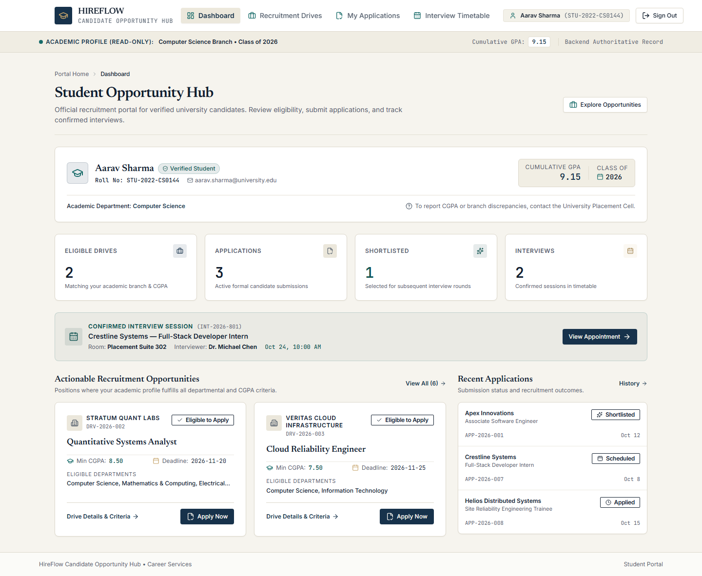
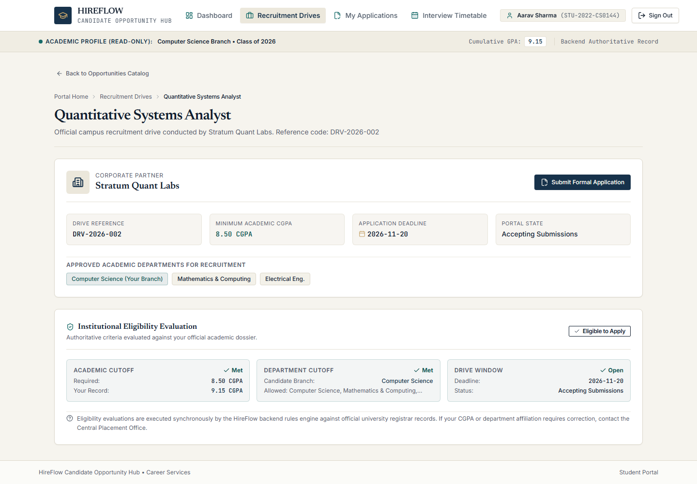
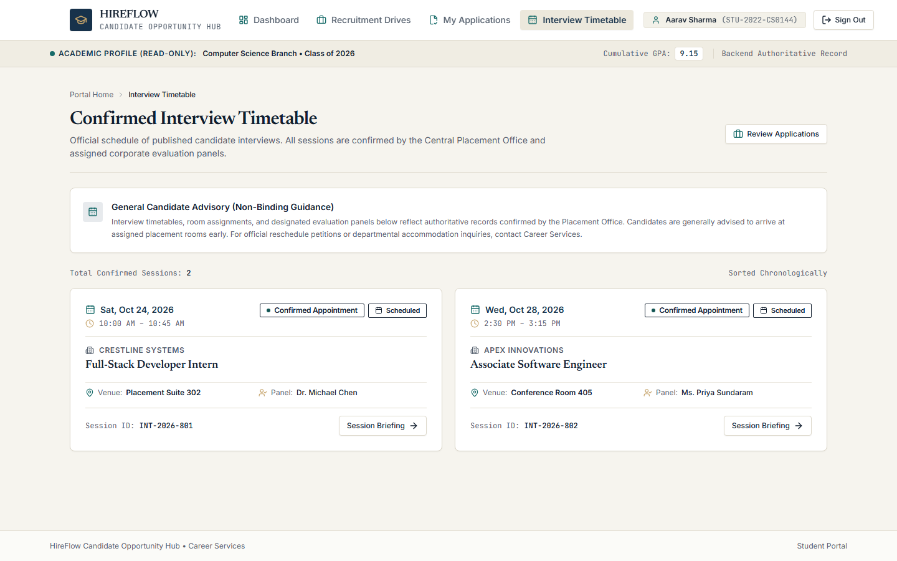
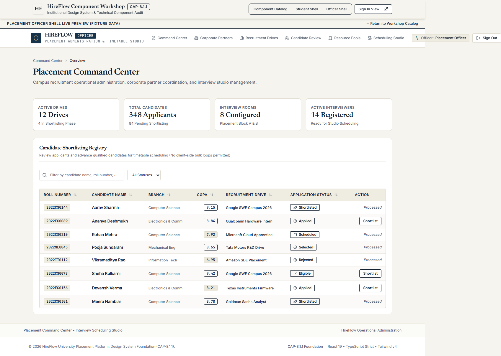

# HireFlow

**Campus Recruitment & Interview Scheduling Platform**

HireFlow is an end-to-end full-stack recruitment coordination platform designed for university placement teams and graduating students. It replaces fragmented spreadsheets, manual eligibility verification, and schedule collisions with a unified workflow connecting recruitment drives, eligibility rules, candidate shortlisting, venue/interviewer resource pools, deterministic interview scheduling, and transactional timetable publication.

The current system combines **Java 21, Spring Boot 4.1.1, PostgreSQL 16, React 19 and TypeScript**. The repository also preserves the complete historical evolution from earlier stages—including a **Java Swing desktop client, pure JDBC infrastructure, multi-threaded TCP socket networking, and a Jakarta EE Servlet/JSP MVC portal**.

> **Project status (October 2026):** Full-stack portfolio release and verified academic prototype. Features complete local test coverage across Core Java, Spring Boot REST, and React/Vitest suites. Designed as an independent university recruitment concept and engineering showcase; not officially deployed or adopted by an educational institution.

---

## Visual Product Tour

The primary user interface is built in React 19 and TypeScript (`hireflow-app/`), communicating with the Spring Boot REST backend (`hireflow-api/`).

### Student Opportunity Hub
Students browse approved employer drives with real-time eligibility evaluation, submit verified applications, and review confirmed interview appointments.



<details>
<summary><strong>View Student Drive Exploration & Eligibility Breakdown</strong></summary>



</details>

<details>
<summary><strong>View Confirmed Student Interview Timetable</strong></summary>



</details>

### Placement Officer Command Center
Placement officers administer employer profiles and recruitment drives, manage interviewer and room resource pools, review candidate pools, run advisory scheduling simulations, and publish confirmed timetables.



---

## Core Capabilities & User Workflows

### For Students (`ROLE_STUDENT`)
- **Opportunity Discovery:** Browse recruitment drives filtered by company, compensation, application deadline, and job profile.
- **Authoritative Eligibility Evaluation:** Backend-evaluated eligibility checks based on branch/discipline, minimum CGPA, and student academic standing.
- **Application Submission:** Submit applications with duplicate-prevention and deadline-enforcement rules.
- **Application Lifecycle Tracking:** Monitor progress across `APPLIED`, `SHORTLISTED`, and `REJECTED` states.
- **Confirmed Interview Briefing:** Access scheduled interview dates, start/end times, allocated campus rooms, and interviewer details.

### For Placement Officers (`ROLE_PLACEMENT_OFFICER`, `ROLE_ADMINISTRATOR`)
- **Company & Drive Administration:** Create and manage participating employers, drive terms, minimum CGPA thresholds, eligible branches, and drive closure.
- **Resource Management:** Register corporate interviewers (with company affiliations and time availability) and campus interview rooms.
- **Candidate Roster & Shortlisting:** Filter applicants by drive and candidate standing, shortlisting applicants for interview allocation.
- **Interview Scheduling Studio:**
  1. *Configure Parameters:* Select drive, interview duration (e.g. 45 min), buffer interval (e.g. 15 min), and daily operating windows.
  2. *Generate Advisory Preview:* Execute deterministic greedy interval scheduling in memory without modifying persistent records.
  3. *Review Unscheduled Candidates:* Review specific constraint violation diagnostics (e.g. interviewer availability exhausted, room conflict).
  4. *Transactional Publication:* Atomically persist confirmed appointments with database-level GiST temporal exclusion checks.
  5. *Timetable Inspection:* View confirmed schedules filtered by date and recruitment drive.

### Operational Scope & Boundaries
- **Recruitment Model:** Officer-managed administration model. Corporate recruiters do not have an external self-service portal; company profiles, interviewers, and schedules are administered on their behalf by university placement officers.
- **Scheduling Philosophy:** The scheduling engine utilizes a **deterministic greedy interval allocation heuristic**, not an artificial intelligence black box or machine learning model. It enforces hard feasibility constraints but does not guarantee global mathematical optimality.
- **Multi-Round Scope:** Single-stage interview allocation per drive. Multi-round technical pipelines, resume parsing, and psychometric assessments are outside current scope.

---

## Architecture & Technology Stack

```text
               ┌────────────────────────────────────────────────────────┐
               │                     Web Browser                        │
               │        React 19 + TypeScript + Vite + Tailwind         │
               └───────────────────────────┬────────────────────────────┘
                                           │ HTTP / JSON (Session + CSRF)
                                           ▼
               ┌────────────────────────────────────────────────────────┐
               │               Spring Boot REST Backend                 │
               │        (hireflow-api / Port 8081 / Java 21)            │
               │                                                        │
               │  [Spring Security]  [Controllers]  [Validation (JSR)]  │
               │         │                  │               │           │
               │  Session / CSRF       Preview Cache   DTO Mappings     │
               └─────────┬──────────────────┬───────────────┬───────────┘
                         │                  │               │
                         │ Reads            │ Writes        │ Scheduling
                         ▼                  ▼               ▼
┌──────────────────────────────┐  ┌──────────────────────────────┐  ┌──────────────────┐
│   Spring Data JPA Entities   │  │   Legacy Bridge Services     │  │ GreedyScheduler  │
│    (ddl-auto = validate)     │  │  (TransactionManager / JDBC) │  │ (Deterministic   │
└──────────────┬───────────────┘  └──────────────┬───────────────┘  │  Interval Alloc) │
               │                                 │                  └──────────────────┘
               │                                 │
               ▼                                 ▼
┌──────────────────────────────────────────────────────────────────────────────────────┐
│                            PostgreSQL 16 Database                                    │
│   • Flyway Migrations (V1 to V5)           • btree_gist Temporal Exclusion           │
│   • HikariCP Connection Pool (JDBC)        • Foreign Keys & Cascading Rules          │
└──────────────────────────────────────────────────────────────────────────────────────┘
```

### Technology Breakdown

| Layer | Technology | Operational Responsibility |
| --- | --- | --- |
| **Language & Core Domain** | Java 21 LTS | Pure domain entities, business rules, custom exceptions, interval algorithms |
| **REST Backend** | Spring Boot 4.1.1, Spring MVC | REST controllers, DTOs, Bean Validation, exception mapping, preview cache |
| **Security & Auth** | Spring Security 6 / 7 | Server sessions (`JSESSIONID`), anti-fixation, `X-CSRF-TOKEN`, role RBAC |
| **Database & Migrations** | PostgreSQL 16, Flyway | Versioned schema evolution (`V1`–`V5`), GiST temporal exclusion constraints |
| **Data Access & Writes** | JDBC, HikariCP, Spring Data JPA | Pure JDBC for all state mutations; Hibernate in validation-only mode (`ddl-auto=validate`) |
| **Frontend Client** | React 19, TypeScript, Vite, Tailwind CSS 4 | Single-page application, TanStack Query, React Router 7, Zod validation |
| **Desktop Client (Preserved)** | Java Swing, SwingWorker | Preserved Stage-1 / Stage-2 desktop management interface |
| **Legacy Web (Preserved)** | Jakarta Servlet 6.0, JSP 3.1 | Preserved Stage-3 server-rendered MVC portal |
| **Quality & Verification** | JUnit 5, MockMvc, Vitest, Playwright | Unit tests, MockMvc contracts, Vitest components, axe-core WCAG audits |

---

## Architectural Deep Dive

### 1. JDBC vs JPA / Hibernate Responsibilities
HireFlow deliberately separates database responsibilities across two layers for academic clarity and strict transactional control:
- **Hibernate / Spring Data JPA:** Used exclusively for read operations on JPA entities (`CompanyJpaEntity`, `RecruitmentDriveJpaEntity`). Hibernate is configured with `spring.jpa.hibernate.ddl-auto=validate`, strictly forbidding runtime schema generation or alteration.
- **Flyway Database Migrations:** All schema tables, indexes, check constraints, foreign keys, and temporal exclusion constraints (`btree_gist`) are managed solely via Flyway migrations (`src/main/resources/db/migration/`).
- **JDBC & TransactionManager:** All state-changing transactional writes—including candidate application submission, status transitions, and interview schedule publication—are executed via raw JDBC repositories managed by a lightweight `TransactionManager` over physical HikariCP connections. This guarantees total transparency into locking, connection boundaries, and transaction isolation.

### 2. Exact Greedy Scheduler Mechanics
The interview scheduling engine (`com.hireflow.scheduler.GreedyScheduler`) allocates candidates to time slots, interviewers, and venues through a deterministic greedy heuristic:
1. **Hard Candidate Filter:** Evaluates only applications with `SHORTLISTED` status. Non-shortlisted candidates are immediately categorized as unscheduled with explicit diagnostic messages.
2. **Deterministic Input Ordering:** Eliminates non-deterministic iteration order by sorting:
   - Applications by `(studentId ASC, driveId ASC, id ASC)`
   - Interviewers by `id ASC`
   - Rooms by `id ASC`
3. **Company Resource Association:** Filters candidate interviewers to match the company hosting the recruitment drive.
4. **Slot Generation:** Generates discrete candidate slot start times stepping forward by `(interviewDuration + bufferDuration)` within the configured daily `TimeWindow`.
5. **Multi-Constraint Validation:** For each slot, candidate, and resource pair, `ConflictChecker` verifies:
   - Slot fits entirely within the allowed operating window.
   - Student has no conflicting overlapping interviews across the entire active pool.
   - Interviewer is available within their configured working hours.
   - Interviewer has no overlapping interviews (including buffer interval).
   - Room has no overlapping bookings (including buffer interval).
6. **Deterministic Session Identifiers:** Generates proposed session IDs using UUID v3 (MD5 name-based) derived from `"hireflow:interview:" + applicationId`. Formatted as 32 uppercase hexadecimal characters without hyphens, these IDs are 100% deterministic across preview regenerations while strictly satisfying the PostgreSQL `VARCHAR(32)` column constraint.

### 3. Ephemeral Preview vs Transactional Publication
HireFlow prevents accidental timetable commits through a two-phase allocation lifecycle:
- **Phase 1: Advisory Preview (`POST /api/v1/officer/scheduling/preview`):**
  - Runs `GreedyScheduler` entirely against read-only state.
  - Generates proposed sessions and captures unscheduled candidate diagnostics.
  - Stores the preview state in an in-memory, thread-safe cache (`SchedulingPreviewCacheService`) identified by a cryptographically unpredictable 128-bit hex token.
  - **Zero database writes or locks are performed.** Previews expire automatically after 15 minutes.
- **Phase 2: Transactional Publication (`POST /api/v1/officer/scheduling/publish`):**
  - Requires the preview token and verifies ownership by the authenticated officer.
  - Atomically consumes the token to prevent replay attacks.
  - Persists appointments inside a JDBC transaction (`TransactionManager.runInTransaction`).
  - Verifies database-level GiST exclusion constraints to prevent concurrent double-booking.
  - Returns a structured `OfficerPublicationSummaryDto` reporting `PublicationOutcome`: `FULL_SUCCESS`, `PARTIAL_SUCCESS`, or `FAILED_ALL_CONFLICTS`.

### 4. Authentication, Session & CSRF Security
- **Server-Side Session Authentication:** Uses Spring Security with HTTP session management (`JSESSIONID`) and `SessionCreationPolicy.IF_REQUIRED`.
- **Session Fixation Defense:** Employs `ChangeSessionIdAuthenticationStrategy` alongside `CsrfAuthenticationStrategy` to migrate session IDs upon authentication.
- **CSRF Token Protection:** Enforces state-changing CSRF defense via `HttpSessionCsrfTokenRepository` (`X-CSRF-TOKEN` header and `_csrf` parameter). All state-changing requests (`/api/v1/auth/login`, `/api/v1/auth/logout`, application submissions, shortlisting, and scheduling publication) require valid CSRF tokens obtained via `GET /api/v1/auth/csrf`.
- **CORS & Least Privilege:** Explicit CORS allowlisting rejecting wildcard credentials. Deny-by-default access policies enforce strict role boundaries across `/api/v1/student/**`, `/api/v1/officer/**`, and `/api/v1/admin/**`.

---

## Repository Layout

```text
hireflow/
├── src/main/java/             # Core Java domain, scheduler, JDBC repositories, Swing GUI, TCP, JSP
├── src/test/java/             # Core Java unit & regression test suites (JUnit 5)
├── src/main/resources/db/     # Flyway database schema migrations (V1 to V5)
├── hireflow-api/              # Spring Boot REST API module (Spring Security, MVC controllers, DTOs)
│   ├── src/main/java/         # REST API application and bridge services
│   └── src/test/java/         # MockMvc, architecture, packaging, and database integration tests
├── hireflow-app/              # Modern React 19 + TypeScript frontend application
│   ├── src/                   # Shells, components, feature modules, TanStack Query hooks, Zod schemas
│   └── tests/e2e/             # Playwright browser suites and axe-core WCAG 2.1 AA accessibility audits
├── infra/cap8-integration/    # Guarded PostgreSQL integration container, Docker Compose, secret script
├── scripts/demo/              # Local Windows demonstration launchers and environment checks
├── docs/                      # Architectural specifications, security analysis, runbooks, and reports
└── .github/workflows/         # GitHub Actions CI workflow (ci.yml)
```

---

## Historical Stages & Architectural Evolution

HireFlow was developed across five distinct architectural milestones, each preserved in Git history and tagged accordingly:

| Stage | Focus & Architecture | Primary Technologies | Historical Checkpoint |
| :---: | :--- | :--- | :---: |
| **Stage 1** | Core Java, Collections, and Swing Desktop Client | Java 21, Java Collections, Swing, In-Memory Repositories | [`v1.0.0-stage1`](https://github.com/XrystalAbyss/hireflow/releases/tag/v1.0.0-stage1) |
| **Stage 2** | Database Persistence, Connection Pooling & TCP | JDBC, HikariCP, PostgreSQL, Multi-threaded TCP Sockets | [`v2.0.0-cap5`](https://github.com/XrystalAbyss/hireflow/releases/tag/v2.0.0-cap5) |
| **Stage 3** | Server-Rendered Jakarta EE MVC Web Portal | Jakarta Servlet 6.0, JSP 3.1, JSTL 3.0, Apache Tomcat | [`v3.0.0-cap6`](https://github.com/XrystalAbyss/hireflow/releases/tag/v3.0.0-cap6) |
| **Stage 4** | Standalone REST Backend & Spring Security | Spring Boot 4.1.1, Spring Security, Hibernate Validation | [`v4.0.0-cap7`](https://github.com/XrystalAbyss/hireflow/releases/tag/v4.0.0-cap7) |
| **Stage 5** | Integrated Full-Stack React & Spring Boot Platform | React 19, TypeScript, Vite, Tailwind CSS, TanStack Query | `develop/stage5` / `main` |

---

## Running HireFlow Locally

### Prerequisites
- **Java Development Kit (JDK):** Version 21 LTS (Eclipse Temurin recommended).
- **Maven:** Version 3.9+ (or use the included `./mvnw.cmd` / `./mvnw` wrapper).
- **Node.js:** Version 22 LTS with `npm` 10+.
- **Database:** PostgreSQL 16 (or Docker Desktop to run the isolated integration container).

### Quickstart Demonstration (Windows)
When running the pre-configured local demonstration with the isolated Docker container:

```powershell
# 1. Verify environment prerequisites and service readiness
.\Check-HireFlow.cmd

# 2. Launch the full-stack demonstration (starts backend on 8081 and frontend on 5174)
.\Launch-HireFlow.cmd
```

- **Frontend Client:** `http://127.0.0.1:5174`
- **Backend REST API:** `http://127.0.0.1:8081/api/v1/health`
- **Isolated PostgreSQL:** `127.0.0.1:55432` / database: `hireflow_cap8_it`

### Building and Testing from Source

#### 1. Core Java & Domain Engine
```powershell
# Build and package root Java modules
.\mvnw.cmd -B clean package -DskipTests

# Run core Java offline unit tests
.\mvnw.cmd test "-Duser.timezone=UTC" "-Dtest=UniversityCampusRoomPolicyTest,SessionIdentityRegressionTest,GreedySchedulerTest,EntityValidationTest,CompanyServiceTest,PasswordHasherTest,CsrfTokenManagerTest,BruteForceThrottlerTest,AuthenticationServiceTest"
```

#### 2. Spring Boot REST Backend
```powershell
# Build and package the REST API executable
.\mvnw.cmd -B -f hireflow-api/pom.xml clean package -DskipTests

# Run architecture and packaging verification tests
.\mvnw.cmd -B -f hireflow-api/pom.xml test "-Dtest=Stage4ArchitectureAndPackagingTest"
```

#### 3. React Frontend Client
```powershell
cd hireflow-app

# Install dependencies cleanly
npm ci

# Typecheck TypeScript sources
npm run typecheck

# Run Oxlint static analysis
npm run lint

# Run Vitest unit & contract suites
npm test

# Generate production Vite bundle
npm run build
```

---

## Quality Assurance & Verification

The codebase is validated across multiple layers of automated testing:

| Layer | Scope / Suites | Local Status | CI Status |
| :--- | :--- | :---: | :---: |
| **Core Java Domain** | Greedy scheduler, room policy, session ID determinism, entity validation, auth, CSRF | **79 / 79 passed** | Verified in CI |
| **Spring Boot REST** | MockMvc contracts, architecture rules, packaging smoke tests | **Passed** | Verified in CI |
| **Isolated PostgreSQL IT** | Health endpoint, authentication, and role authorization against real PostgreSQL 16 | **Passed** | Verified in CI |
| **Frontend TypeScript** | TypeScript strict mode typechecking across shells, features, and components | **0 errors** | Verified in CI |
| **Frontend Lint** | Oxlint AST static analysis across 117 source files | **0 errors** | Verified in CI |
| **Frontend Vitest** | Component tests, Zod contract parsing, route guards, navigation cache | **147 / 147 passed** (5 live skipped) | Verified in CI |
| **Frontend Build** | Production Vite tree-shaking and bundle generation | **0 errors** | Verified in CI |
| **Accessibility (a11y)** | axe-core automated audits for WCAG 2.1 AA across Student Opportunity Hub | **Passed** | Local drill |

> **CI Pipeline Notice:** Historical local test figures (e.g. 883 passing tests) reflect specific past development snapshots. Current repository integrity is verified on GitHub Actions (`.github/workflows/ci.yml`), which builds and tests the exact commit across multi-stage jobs on Ubuntu with an isolated PostgreSQL 16 service container.

---

## Security & Data Boundaries

- **Database Safeguards:** Local test scripts and integration harnesses enforce strict port (`55432`) and database sentinel markers (`_integration_sentinel`) before executing any queries, preventing destructive operations against unrelated PostgreSQL installations.
- **Credential Hygiene:** No production credentials or secrets are committed. Passwords in demonstration and testing environments are passed dynamically via environment variables (`APP_DB_PASSWORD`, `HIREFLOW_IT_APP_PASSWORD`) or secret files.
- **Synthetic Demonstration Records:** All candidate records, corporate partner names, and job postings are entirely synthetic. Any resemblance to real corporate recruiting relationships or actual student information is purely coincidental.
- **Academic & Portfolio Disclaimer:** HireFlow is an independently designed engineering portfolio project. References to university placement workflows, campus room numbers, and academic calendars describe the demonstration scenario, not an official university deployment or institutional endorsement.

---

## Recommended Repository Metadata

- **GitHub Repository Description:**
  > Full-stack university recruitment platform featuring deterministic interview scheduling, PostgreSQL GiST exclusion constraints, Spring Boot REST API, and React 19 interface.
- **Repository Topics:**
  `java-21`, `spring-boot`, `react19`, `typescript`, `postgresql`, `flyway`, `scheduling-algorithm`, `recruitment-system`, `fullstack`, `tailwind-css`
