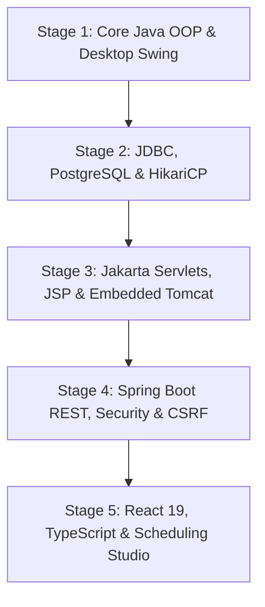

# HIREFLOW — Campus Recruitment & Interview Scheduling System
## Comprehensive Technical System Explanation & Architectural Defense
**Milestone:** CAP-8.6.4 Final Academic Release  
**Target Audience:** University Advanced Java External Examiners, Faculty Evaluation Committee, Principal Software Engineers  
**Project Repository:** `https://github.com/XrystalAbyss/hireflow` (branch: `develop/stage5`)

---

## 1. Executive Summary & Problem Motivation

Campus recruitment across large universities involves multi-dimensional resource scheduling under severe operational constraints:
1. **Academic Eligibility Rules:** Filtering thousands of student applicants across academic departments (CSE, ECE, MECH, etc.), minimum Cumulative Grade Point Average (CGPA) thresholds, active disciplinary status, and registration deadlines.
2. **Resource Scarcity & Operational Bottlenecks:** Coordinating dozens of corporate recruitment drives with corporate interview panels, student availability, and physical room capacity across academic blocks (K-Block and L-Block).
3. **Double-Booking & Conflict Prevention:** Real-time prevention of student overlapping interviews, interviewer double-bookings, and physical venue collisions with buffer intervals for candidate handover.
4. **Transparency & Auditability:** Ensuring that scheduling decisions are deterministic, explainable, inspectable before durable commitment, and resistant to concurrent booking conflicts.

**HireFlow** solves this challenge through an evolutionary, 5-stage architectural pipeline designed and implemented in Java 21, JDBC, PostgreSQL, Jakarta Servlets, Spring Boot, and React 19 / TypeScript.

---

## 2. High-Level Architectural Evolution (5-Stage Model)

The project deliberately illustrates the architectural maturation of enterprise software over five clearly demarcated milestones:

### Stage 1: Core Java Foundation & Object-Oriented Architecture
- **Language & Runtime:** Pure Java 21, leveraging Java Records, Pattern Matching for `switch`, sealed interfaces, and defensive copying.
- **Data Structures & Collections:** Generics, `ConcurrentHashMap`, `ArrayList`, `TreeSet`, and custom generic repository patterns (`Repository<T, ID>`).
- **Scheduling Engine:** A deterministic greedy scheduling algorithm (`GreedyScheduler`) with conflict detection (`ConflictChecker`) running in $O(N \log N + N \cdot R \cdot I)$ time.
- **Desktop UI:** Java Swing (`JFrame`, `CardLayout`, `JTable`, `DefaultTableModel`, `SwingWorker` for background asynchronous processing on the EDT).

### Stage 2: Enterprise Relational Persistence & Concurrency
- **Database Engine:** PostgreSQL 16.
- **Connection Pooling:** HikariCP (`DataSourceProvider`) with fail-fast initialization, strict leak detection thresholds, and bounded pool sizing.
- **ACID Transactions:** Manual transaction demarcation (`setAutoCommit(false)`), explicit `commit()`, and fail-safe `rollback()` inside robust `try-with-resources` blocks.
- **Relational Integrity:** Unique constraints (`uq_application_student_drive`), exclusion constraints via PostgreSQL `btree_gist` (`tsrange` overlap prevention for rooms, students, and interviewers), and deterministic row-level lock ordering to eliminate deadlocks.
- **Database Migrations:** Versioned schema evolution managed through Flyway.

### Stage 3: Java Web Enterprise Foundation
- **Web Runtime:** Jakarta Servlets 6.0 and JavaServer Pages (JSP) hosted on embedded Apache Tomcat 11.
- **Architectural Pattern:** Model-View-Controller (MVC) with custom front-controller servlets (`StudentApplicationController`, `OfficerSchedulingController`).
- **Session Security:** Standard HTTP session management (`HttpSession`), server-side authentication filtering, and cryptographic CSRF token validation.

### Stage 4: Enterprise Spring Boot REST API
- **Framework:** Spring Boot 4.1.1 running on Java 21.
- **Security Architecture:** Spring Security filter chain enforcing session fixation protection, BCrypt password hashing, role-based access control (`ROLE_STUDENT`, `ROLE_PLACEMENT_OFFICER`, `ROLE_ADMINISTRATOR`), and anti-CSRF headers.
- **Authoritative Validation:** Jakarta Bean Validation (`@Valid`, `@NotNull`, `@Min`, `@Size`) combined with domain-level business invariants in transactional service boundaries.
- **HTTP Semantics:** Strict RESTful design with status code contracts (200 OK, 201 Created, 207 Multi-Status, 400 Bad Request, 401 Unauthorized, 403 Forbidden, 404 Not Found, 409 Conflict, 410 Gone).

### Stage 5: Contemporary Web Frontend & Scheduling Studio
- **Frontend Stack:** React 19, TypeScript 5, Vite 8, Tailwind CSS, TanStack Query, Radix UI.
- **Institutional Design System:** Institutional x Contemporary visual language tailored for university placement workflows.
- **Flagship Feature — Scheduling Studio:** Interactive recruitment campaign configuration, real-time timetable advisory preview, visual multi-wing time grid, accessible matrix data table, and multi-session transactional publication workflow.

---

## 3. Core Subsystems & Domain Workflows

### 3.1 Recruitment Drive & Eligibility Subsystem
- **Domain Entities:** `Company`, `RecruitmentDrive`, `Student`, `Application`.
- **Eligibility Engine (`EligibilityService`):**
  - **Status Invariant:** Candidate student account must be active.
  - **CGPA Invariant:** Student CGPA must be greater than or equal to drive's `minimumCgpa`.
  - **Department Invariant:** Student branch must belong to `drive.getAllowedBranches()`.
  - **Deadline Invariant:** System date must be on or before `drive.getApplicationDeadline()`.
  - **Status Invariant:** Drive must be open (`drive.isOpen()`).
  - **Uniqueness Invariant:** Duplicate applications for the same drive are rejected at both business service and PostgreSQL constraint levels (`uq_application_student_drive`).

### 3.2 Greedy Scheduling Engine (`GreedyScheduler`)
- **Deterministic Scheduling:** Given identical inputs (shortlisted applications, available interviewers, eligible rooms, and time parameters), the scheduler produces the exact same schedule every time.
- **Algorithm Operation:**
  1. Sorts applications deterministically by CGPA descending, breaking ties by application ID ascending.
  2. Generates candidate time slots of length `durationMinutes` starting from `windowStart`, incrementing by `durationMinutes + bufferMinutes` until `windowEnd`.
  3. Iterates through candidate slots and tests candidate triads `(slot, interviewer, room)`.
  4. Queries `ConflictChecker` to ensure no student, interviewer, or room has an overlapping session or buffer violation.
  5. Schedules valid triads into `InterviewSession` objects and assigns them to the candidate; if no conflict-free triad exists across the window, the candidate is recorded in the unscheduled backlog with an explicit diagnostic reason.

### 3.3 Two-Phase Advisory Scheduling Workflow
To prevent premature or irreversible database mutations during schedule optimization:
1. **Phase 1 — Advisory Preview (`POST /api/v1/officer/scheduling/preview`):**
   - The scheduler runs in-memory against current PostgreSQL availability.
   - Generates a non-mutating preview stored in `SchedulingPreviewCacheService` associated with a cryptographically secure preview token (`PREV-...`).
   - The preview token has a bounded lifespan (15 minutes) and is strictly owned by the generating officer's account.
   - Zero database records are committed during preview generation.
2. **Phase 2 — Multi-Session Publication (`POST /api/v1/officer/scheduling/publish`):**
   - Officer inspects the proposed schedule, verifies resource assignments, and submits the signed publication token.
   - The server verifies token ownership, validates expiry, and consumes the token (single-use semantics preventing replay).
   - Revalidates current resource availability against PostgreSQL to detect any concurrent bookings.
   - Durably commits confirmed appointments and updates candidate applications to `SCHEDULED` status.
   - Emits HTTP 200 for full confirmation, HTTP 207 for partial success with diagnostic recovery instructions, or HTTP 409 if conflicts block all sessions.

---

## 4. Architectural Invariants & Safety Guarantees

1. **Authoritative Backend Validation:** Frontend form validation is an ergonomic aid; the Java backend independently revalidates all invariants.
2. **Database Isolation & Protection:** Demonstration data is hosted in an isolated PostgreSQL container (`hireflow-cap8-postgres` on port 55432). Host port 5432 is forbidden.
3. **No Phantom State:** Student academic records and scheduling timetables are never faked or fabricated in live mode.
4. **Atomic Resource Locks:** Row-level locking order (`SELECT ... FOR UPDATE` ordered by room ID and interviewer ID) guarantees deadlock-free concurrent scheduling publications.
5. **Preserved Educational Stages:** Stage 1 (Swing), Stage 2 (JDBC), and Stage 3 (Servlets) remain functional and compilable alongside Stage 4 (Spring Boot) and Stage 5 (React).
