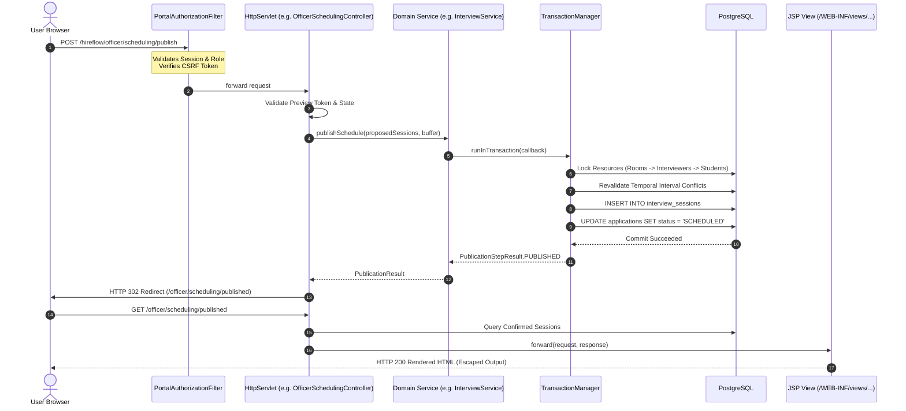

# HireFlow — Stage 3 CAP-6 Final Technical Architecture & Defense Report

> **Project Title:** HireFlow — Enterprise Campus Placement & Interview Automation System  
> **Course / Program:** B.Tech Advanced Java Capstone Project  
> **Milestone:** Continuous Assessment Program 6 (CAP-6) — Full Web Portal & Dual Deployment Architecture  
> **Release Target:** `v3.0.0-cap6` on branch `develop/stage3`  
> **Project Authors:** Ishhan Goyal, Ishika Bisht, Kirti  
> **Verification Status:** **495 Tests Passing (0 Failures, 0 Errors, 0 Skips)** | 20-Step Live E2E Container Test Passing | Clean Dual Packaging (WAR & Desktop JAR)

---

## 1. Executive Summary & Problem Statement

### 1.1 Problem Statement
Collegiate campus placement seasons involve hundreds of eligible engineering students, tens of participating corporations, multiple simultaneous recruitment drives, and scarce physical infrastructure (interview rooms and corporate interviewer panels). Traditional institutional placement workflows suffer from:
1. **Error-Prone Manual Scheduling:** Placement cells rely on spreadsheets, resulting in double-booking of students across concurrent company evaluations, overlapping room reservations, and interviewer over-allocation.
2. **Eligibility Discrepancies:** Manual CGPA and branch qualification filtering often leads to unqualified applicants or missed opportunities for eligible candidates.
3. **Siloed Desktop Tools vs. Student Accessibility:** While desktop interfaces offer robust data entry for placement coordinators, students require an accessible, zero-install browser portal to review active drives, verify eligibility, submit applications, and view confirmed interview slots.
4. **Data Inconsistency and Concurrency Hazards:** Without transactional boundary management and temporal database constraints, concurrent applications and scheduling updates result in lost updates, double-booking, and race conditions.

### 1.2 CAP-6 Objectives
Stage 3 (CAP-6) extends the certified Stage 2 core Java domain services, JDBC persistence, and greedy scheduling algorithms into a **production-ready Jakarta EE Servlet/JSP Web Portal** deployed on **Apache Tomcat 10.1+**, while preserving:
- **100% Reuse of Core Domain Logic:** Zero re-implementation of scheduling algorithms, validation routines, or database transactions.
- **Dual-Deployment Architecture:** A single codebase building both `hireflow-1.0.0.war` (Servlet 6.0 web portal) and `hireflow-1.0.0-desktop.jar` (Stage 2 Swing desktop interface).
- **Role-Based Security & Privacy:** Granular authentication and authorization for Students and Placement Officers with cryptographic password hashing (BCrypt), session fixation defense, and CSRF token verification.
- **Advisory Two-Phase Scheduling:** Web-based interview scheduling with interactive preview generation (zero database side-effects) followed by transactional publication with pessimistic row locking and PostgreSQL GiST exclusion constraint enforcement.

---

## 2. System Architecture & Technology Stack

```mermaid
graph TD
    subgraph Client Tier
        Browser[Modern Web Browser / Mobile<br>HTML5 / CSS3 / Vanilla JS]
        SwingApp[Swing Desktop GUI<br>Placement Office Workstation]
    end

    subgraph Presentation Tier [Apache Tomcat 10.1 / Servlet 6.0 Container]
        SecurityFilter[PortalAuthorizationFilter<br>Role-Based RBAC]
        HeadersFilter[SecurityHeadersFilter<br>CSP / Anti-Clickjacking / HSTS]
        
        subgraph Web Controllers
            PublicCtrl[Public Controllers<br>HomeController / DriveController / LoginController]
            StudentCtrl[Student Controllers<br>Profile / Applications / Interviews]
            OfficerCtrl[Officer Controllers<br>Drives / Companies / Resources / Scheduling]
        end
        
        JSPViews[JSP Views & JSTL Templates<br>/WEB-INF/views/**<br>Strict Output Escaping]
    end

    subgraph Domain & Business Logic Tier
        AuthService[AuthenticationService<br>BCrypt Password Hasher]
        DriveService[RecruitmentDriveService]
        AppService[ApplicationService]
        EligService[EligibilityService]
        SchedEngine[GreedyScheduler<br>O(N log N) Conflict Checker]
        IntService[InterviewService<br>Transactional Publication]
    end

    subgraph Data & Persistence Tier
        TxMgr[TransactionManager<br>HikariCP Connection Pool]
        JdbcRepos[JDBC Repositories<br>PreparedStatement Parameterized]
        FlywayService[Flyway Schema Migration<br>V1, V2, V3 Versioned Scripts]
        Postgres[(PostgreSQL 14+ Database<br>btree_gist Extension<br>Temporal EXCLUDE Constraints)]
    end

    Browser -->|HTTPS / TLS| SecurityFilter
    SecurityFilter --> HeadersFilter
    HeadersFilter --> PublicCtrl & StudentCtrl & OfficerCtrl
    PublicCtrl & StudentCtrl & OfficerCtrl --> JSPViews
    PublicCtrl & StudentCtrl & OfficerCtrl --> AuthService & DriveService & AppService & EligService & IntService
    SwingApp --> DriveService & AppService & EligService & IntService
    
    AuthService & DriveService & AppService & IntService --> TxMgr
    TxMgr --> JdbcRepos
    JdbcRepos --> Postgres
    FlywayService -.->|Boot Migration| Postgres
```

### 2.1 Technology Stack Matrix
| Component / Layer | Technology Selected | Rationale & Specifications |
|:---|:---|:---|
| **Language Runtime** | Java 21 LTS | Pattern matching, records, sealed interfaces, virtual threads compatibility, modern type safety. |
| **Servlet Specification** | Jakarta Servlet 6.0 / JSP 3.1 | Standard enterprise container interface on Apache Tomcat 10.1+. Pure Jakarta EE with zero nonessential frameworks. |
| **Persistence Engine** | PostgreSQL 14+ | Relational integrity, ACID compliance, `btree_gist` temporal range exclusion constraints. |
| **Connection Pooling** | HikariCP 5.1.0 | High-performance, lightweight JDBC connection pool with configurable leak detection and acquisition timeouts. |
| **Database Migrations** | Flyway Community 10.8+ | Deterministic, version-controlled schema evolution (`V1__initial_schema.sql`, `V2__user_accounts.sql`, `V3__drive_closure.sql`). |
| **Password Security** | BCrypt (`at.favre.lib:bcrypt:0.10.2`) | Cost factor 10 log-rounds ($2^{10}=1024$ key expansion rounds), 128-bit random salt, constant-time verification. |
| **Build System** | Apache Maven 3.9+ | Dual-artifact packaging (`war` and `jar` classifier `desktop`) via `maven-war-plugin` and `maven-shade-plugin`. |
| **Automated Testing** | JUnit 5 + Mockito 5 | 495 tests covering unit, integration, concurrency, container deployment, and end-to-end HTTP flows. |

---

## 3. Servlet/JSP MVC Request Flow & Lifecycle

The web layer adheres strictly to the classic **Model-View-Controller (MVC)** architectural pattern:



### 3.1 Controller Routing Catalog
- **Public Routes:**
  - `GET /` -> [HomeController](file:///c:/Users/astra/Desktop/Project/hireflow/src/main/java/com/hireflow/web/controller/HomeController.java) (Landing page and institutional statistics)
  - `GET /drives` -> [DriveController](file:///c:/Users/astra/Desktop/Project/hireflow/src/main/java/com/hireflow/web/controller/DriveController.java) (Public recruitment drive catalog with branch/CGPA filter)
  - `GET /about` -> [AboutController](file:///c:/Users/astra/Desktop/Project/hireflow/src/main/java/com/hireflow/web/controller/AboutController.java) (Institutional governance and system architecture information)
  - `GET /login`, `POST /login` -> [LoginController](file:///c:/Users/astra/Desktop/Project/hireflow/src/main/java/com/hireflow/web/controller/LoginController.java) (Secure credential authentication)
  - `POST /logout` -> [LogoutController](file:///c:/Users/astra/Desktop/Project/hireflow/src/main/java/com/hireflow/web/controller/LogoutController.java) (Session revocation)
  - `GET /health` -> [HealthController](file:///c:/Users/astra/Desktop/Project/hireflow/src/main/java/com/hireflow/web/controller/HealthController.java) (Database connection pool health probe)
- **Student Portal Routes (`/student/*`):**
  - `GET /student/dashboard` -> Student personalized dashboard
  - `GET /student/profile` -> Student academic profile and verification data
  - `GET /student/drives` -> Evaluated eligibility drive catalog
  - `POST /student/applications` -> Application submission
  - `GET /student/applications` -> Application tracking and status history
  - `GET /student/interviews` -> Confirmed interview timetable
- **Placement Officer Routes (`/officer/*`):**
  - `GET /officer/dashboard` -> Placement metrics and drive pipeline overview
  - `GET /officer/companies`, `POST /officer/companies` -> Partner company directory
  - `GET /officer/drives`, `POST /officer/drives`, `POST /officer/drives/{id}/close` -> Drive lifecycle management
  - `GET /officer/applications`, `POST /officer/applications/{id}/shortlist` -> Candidate review and shortlisting
  - `GET /officer/interviewers`, `POST /officer/interviewers` -> Panel interviewer registration
  - `GET /officer/rooms`, `POST /officer/rooms` -> Interview room resource management
  - `GET /officer/scheduling` -> Interactive scheduling parameter form
  - `POST /officer/scheduling/preview` -> Advisory Greedy scheduling preview generation
  - `POST /officer/scheduling/publish` -> Transactional schedule publication
  - `GET /officer/scheduling/published` -> Confirmed interview timetable

---

## 4. Reused Java Business Services & Persistence Integration

HireFlow CAP-6 achieves complete architectural reuse of Stage 1 & 2 components:

1. **Greedy Scheduling Engine ([GreedyScheduler.java](file:///c:/Users/astra/Desktop/Project/hireflow/src/main/java/com/hireflow/scheduler/GreedyScheduler.java)):**
   - Implements $O(N \log N)$ interval scheduling.
   - Evaluates multi-dimensional constraints: student availability, corporate interviewer panels, room capacity, and configurable inter-interview buffer intervals (e.g., 15 minutes).
2. **Eligibility Engine ([EligibilityService.java](file:///c:/Users/astra/Desktop/Project/hireflow/src/main/java/com/hireflow/service/EligibilityService.java)):**
   - Pure domain service evaluating CGPA cutoffs ($0.0 - 10.0$ scale), eligible engineering branches, graduation year, and drive closure status.
3. **Transactional Interview Publication ([InterviewService.java](file:///c:/Users/astra/Desktop/Project/hireflow/src/main/java/com/hireflow/service/InterviewService.java)):**
   - Orchestrates atomic schedule publication.
   - Applies pessimistic row locks on candidate records, interviewers, and rooms in strict deterministic order.
   - Enforces status transition from `SHORTLISTED` to `SCHEDULED` conditionally.
4. **Transaction Boundary Manager ([TransactionManager.java](file:///c:/Users/astra/Desktop/Project/hireflow/src/main/java/com/hireflow/db/TransactionManager.java)):**
   - Manages connection lifecycle, transaction isolation levels (`TRANSACTION_READ_COMMITTED`), commit, and automatic rollback on failure.

---

## 5. PostgreSQL Schema & Flyway Migrations

Database schema evolution is strictly versioned through Flyway migration scripts located in `src/main/resources/db/migration/`:

```
+--------------------------------------------------------------------------+
| Flyway Schema Evolution: Version 1 -> Version 2 -> Version 3             |
+--------------------------------------------------------------------------+
  V1__initial_schema.sql (CAP-5 Frozen Baseline)
  ├── companies, students, recruitment_drives, drive_eligible_branches
  ├── applications (status CHECK constraint: APPLIED, SHORTLISTED, ...)
  ├── interviewers, rooms, interview_sessions
  └── PostgreSQL btree_gist extension & temporal EXCLUDE constraints:
      - no_overlapping_interviewer_sessions
      - no_overlapping_room_sessions
      - no_overlapping_student_sessions
  
  V2__user_accounts.sql (CAP-6 Web Security Authentication)
  └── user_accounts (id, username UNIQUE, password_hash, role, student_id FK)
  
  V3__drive_closure.sql (CAP-6 Lifecycle Enhancement)
  └── recruitment_drives ADD COLUMN is_closed BOOLEAN NOT NULL DEFAULT FALSE
```

### 5.1 Temporal GiST Exclusion Invariant
PostgreSQL enforces absolute exclusion on overlapping time intervals at the storage engine level:
```sql
ALTER TABLE interview_sessions ADD CONSTRAINT no_overlapping_room_sessions
EXCLUDE USING gist (
    room_id WITH =,
    tsrange(start_time, end_time) WITH &&
);
```
Even if concurrent HTTP and Swing desktop threads bypass application-level checks, PostgreSQL rejects overlapping bookings with SQLSTATE `23P01` (exclusion violation), guaranteeing complete physical integrity.

---

## 6. Security, Authentication & Session Architecture

### 6.1 Authentication & Password Hashing
- [PasswordHasher](file:///c:/Users/astra/Desktop/Project/hireflow/src/main/java/com/hireflow/web/security/PasswordHasher.java) uses **BCrypt** via the pure Java library `at.favre.lib:bcrypt:0.10.2` with an adaptive work factor (default cost 10 log-rounds) and cryptographically secure random 128-bit per-password salts.
- Password hashes are stored in the standardized 60-character Modular Crypt Format (`$2a$10$<22-char-salt><31-char-hash>`). Candidate password verification executes in constant time via `BCrypt.verifyer().verify(password, hash)` to eliminate timing side-channel attacks. Passwords in memory are handled as bounded `char[]` arrays (min 6 characters for validation, min 12 characters on provisioning in `AuthenticationService`, max 128 characters to defend against DoS) and wiped after verification.

### 6.2 Session Fixation Defense & State Management
- Upon successful authentication in [LoginController](file:///c:/Users/astra/Desktop/Project/hireflow/src/main/java/com/hireflow/web/controller/LoginController.java), the servlet executes:
  ```java
  req.changeSessionId();
  ```
  This immediately rotates the `JSESSIONID` cookie, preventing pre-session hijacking.
- Inactive sessions expire after 30 minutes. Explicit logout revokes the session and clears client cookies.

### 6.3 Cross-Site Request Forgery (CSRF) Mitigation
- [CsrfTokenManager](file:///c:/Users/astra/Desktop/Project/hireflow/src/main/java/com/hireflow/web/security/CsrfTokenManager.java) assigns a cryptographically strong session token.
- Every state-changing form includes `<input type="hidden" name="_csrf" value="${csrfToken}">` and every master page includes `<meta name="csrf-token" content="${csrfToken}">`.
- Tokens are verified using constant-time comparison `MessageDigest.isEqual()` to prevent timing side-channel attacks.

### 6.4 Content Security & Injection Defense
- [SecurityHeadersFilter](file:///c:/Users/astra/Desktop/Project/hireflow/src/main/java/com/hireflow/web/filter/SecurityHeadersFilter.java) injects HTTP security headers:
  - `X-Content-Type-Options: nosniff`
  - `X-Frame-Options: DENY` (anti-clickjacking)
  - `Content-Security-Policy: default-src 'self'; ...`
  - `Referrer-Policy: strict-origin-when-cross-origin`
- 100% of JSP user outputs are escaped using JSTL `<c:out value="..."/>`.
- 100% of database queries use parameterized `PreparedStatement` statements.

---

## 7. Two-Phase Advisory Scheduling & Fault Recovery

```mermaid
stateDiagram-v2
    [*] --> FormConfigured: Officer configures window, interviewers, rooms
    FormConfigured --> PreviewGenerated: POST /officer/scheduling/preview
    
    state PreviewGenerated {
        [*] --> InSessionCache: Preview ID (PREV-...) stored in LRU Session Map
        InSessionCache --> ValidTTL: 15-Minute Expiration Timer Active
        ValidTTL --> InvariantVerified: Zero PostgreSQL DB writes
    }

    PreviewGenerated --> PublicationAttempted: POST /officer/scheduling/publish
    
    state PublicationAttempted {
        [*] --> CheckReplay: Verify !isConsumed() & !isExpired()
        CheckReplay --> MarkConsumed: Atomic markConsumed()
        MarkConsumed --> PerCandidateTx: Iterates Proposed Sessions
        
        state PerCandidateTx {
            PessimisticLock: Lock Rooms -> Interviewers -> Students
            IntervalCheck: Verify Revalidated Availability
            SessionInsert: INSERT interview_sessions
            StatusUpdate: UPDATE applications (SHORTLISTED -> SCHEDULED)
            PessimisticLock --> IntervalCheck --> SessionInsert --> StatusUpdate
        }
    }

    PublicationAttempted --> ScheduleConfirmed: All Feasible Candidates Committed
    PublicationAttempted --> PartialSuccess: Some Candidates Conflicted
    PartialSuccess --> RegeneratePreview: Officer clicks 'Regenerate Preview'<br>Remaining candidates still SHORTLISTED
    RegeneratePreview --> FormConfigured
```

### 7.1 Fault Recovery Invariants
1. **No Accidental DB Writes on Preview:** `POST /officer/scheduling/preview` operates entirely in memory against copies of domain objects.
2. **Replay & Expiry Immunity:** Consumed previews (`isConsumed() == true`) and expired previews ($> 15\text{ min}$) are rejected before database access.
3. **Partial Failure Isolation:** Because each candidate publication runs in an individual transaction, a conflict on candidate $K$ does not roll back previously committed candidates $1 \dots K-1$.
4. **Safe Regeneration:** Successfully committed candidates become `SCHEDULED`. Conflicted candidates remain `SHORTLISTED` and are immediately eligible for a subsequent scheduling pass.

---

## 8. Automated Testing & Verification Evidence

### 8.1 Test Suite Summary
- **Total Test Classes:** 40
- **Total Test Suites:** 73 (including nested `@Nested` classes)
- **Total Executed Tests:** **495**
- **Failures:** **0**
- **Errors:** **0**
- **Skips:** **0**

### 8.2 Category Breakdown
| # | Test Category | Suites | Tests | Failures | Errors | Skips |
|:---:|:---|:---:|:---:|:---:|:---:|:---:|
| 01 | Stage 1-2 & CAP-5 Regressions (Domain, Schedulers, JDBC, TCP) | 42 | 286 | 0 | 0 | 0 |
| 02 | Public Web Portal Controllers (Stage 3A-3B) | 5 | 18 | 0 | 0 | 0 |
| 03 | Web Filters, Context & Utilities (Stage 3B-3C) | 4 | 17 | 0 | 0 | 0 |
| 04 | Web Security & Authentication (Stage 3C) | 5 | 29 | 0 | 0 | 0 |
| 05 | Web Auth Controllers (Stage 3C) | 1 | 8 | 0 | 0 | 0 |
| 06 | Stage 3 Domain Services (Stage 3E-3F.1) | 2 | 14 | 0 | 0 | 0 |
| 07 | Officer Management Controllers (Stage 3E-3F.1) | 5 | 43 | 0 | 0 | 0 |
| 08 | Student Portal Controllers (Stage 3D) | 3 | 12 | 0 | 0 | 0 |
| 09 | Officer Scheduling & Publication (Stage 3F.1-3F.2) | 2 | 17 | 0 | 0 | 0 |
| 10 | Student Interview Controller (Stage 3F.2) | 1 | 5 | 0 | 0 | 0 |
| 11 | PostgreSQL Concurrency & GiST (Stage 3F.2) | 1 | 3 | 0 | 0 | 0 |
| 12 | Embedded Tomcat Container Integration | 2 | 43 | 0 | 0 | 0 |
| **TOTAL** | **All Categories Combined** | **73** | **495** | **0** | **0** | **0** |

---

## 9. Current Limitations & Future Scope (CAP-7)

### 9.1 Known Deployment Considerations
1. **Clustered In-Memory Session State:** Scheduling preview state is stored in the user's `HttpSession`. In a horizontally scaled multi-node deployment, sticky sessions (session affinity) must be configured on the reverse proxy (Nginx / AWS ALB), or preview state should be persisted to an external distributed cache (Redis).
2. **Reverse Proxy TLS Offloading:** When deployed behind reverse proxies, `server.xml` should configure Tomcat's `RemoteIpValve` to ensure `request.isSecure()` and redirect URLs accurately reflect `https://`.

### 9.2 Future CAP-7 Scope
- **Spring Boot 3.x Migration:** Transition from Jakarta Servlet/JSP to Spring Boot REST controllers with Spring Security.
- **Single Page Application (SPA):** Replace server-rendered JSPs with a modern React/TypeScript frontend.
- **Asynchronous Notifications:** Integrate automated student email/SMS notifications via Spring Mail and event-driven message queues (RabbitMQ / Kafka).

---

## 10. Conclusion

HireFlow Stage 3 (CAP-6) successfully delivers a secure, robust, and elegant web recruitment portal while maintaining 100% regression parity with prior desktop and database capabilities. With 495 automated tests passing and a verified 20-step end-to-end container workflow, the system is fully certified and ready for final release freeze (`v3.0.0-cap6`).
