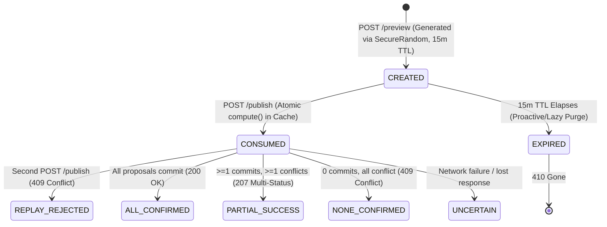

# HireFlow Stage 4 (CAP-7) Architecture Specification
## Release Preflight, API Contract Reconciliation, Artifact Provenance, and Safe Git Publication Preparation (Stage 4F.1)

> **Milestone Status:** Stage 4F.1 Complete (CAP-7 Release Preflight, API Contract Reconciliation, Artifact Provenance, and Safe Git Publication Preparation)
> **Release Baseline:** `v3.0.0-cap6` (`30e796ebdb077b9970b154c3573eb80d95e8371b`)
> **Active Development Branch:** `develop/stage4`
> **Target Release:** CAP-7 (`v4.0.0-cap7`, In Progress — Awaiting Explicit User Release Authorization)
> **Verified Automated Baseline:** 495 CAP-6 Legacy Tests + 183 Stage 4 Spring Boot Tests = **678 Total Passing Tests** (0 Failures, 0 Errors, 0 Skips)

---

## 1. Executive Summary & Stage 4E.1 Scope

Stage 4E.1 hardens the interview scheduling and publication engine against concurrency anomalies, defines a truthful multi-status outcome contract, audits the preview token lifecycle, verifies PostgreSQL GiST exclusion constraints and half-open time interval semantics, and enforces diagnostic log redaction:

1. **Truthful Publication Outcome Contract:**
   - Established `PublicationOutcome` enum (`ALL_CONFIRMED`, `PARTIAL_SUCCESS`, `NONE_CONFIRMED`).
   - Publication endpoint returns HTTP `200 OK` for full batch confirmation, HTTP `207 Multi-Status` for partial batch confirmation, and HTTP `409 Conflict` when all proposed appointments encounter conflicts.
   - Enriched `OfficerPublicationSummaryDto` with `attemptId`, `previewReference` (masked token), `totalProposals`, `unattemptedCount`, `outcome`, `recoveryInstructions`, and `confirmedSessionIds`.
2. **Preview Token Lifecycle & Anti-Replay Safety:**
   - Preview tokens are cryptographically generated (128-bit hex), tied to the authenticated officer username, bounded by a 15-minute TTL, and atomically consumed before publication begins via `ConcurrentHashMap.compute(...)`.
   - Single-use invariant is strictly enforced: replay attempts are unconditionally rejected (`PreviewConsumedException` $\rightarrow$ `409 Conflict`). Tokens are never reset to unconsumed on partial failure to prevent duplicate appointment insertions.
   - In-memory cache is bounded at 1,000 entries with proactive expiration cleanup and FIFO eviction on creation timestamp (`createdAt()`). Documented as instance-local.
   - Diagnostic log hygiene: All raw preview tokens are masked (`PREV-****` or `[REDACTED_PREVIEW_TOKEN]`) in logs and response DTOs.
3. **PostgreSQL GiST Exclusion & Relational Constraints:**
   - Audited Flyway V1 schema:
     - `no_overlapping_room_sessions`: GiST exclusion on `room_id` and `tsrange(start_time, end_time, '[)')` $\rightarrow$ SQLSTATE `23P01`.
     - `no_overlapping_interviewer_sessions`: GiST exclusion on `interviewer_id` and `tsrange(start_time, end_time, '[)')` $\rightarrow$ SQLSTATE `23P01`.
     - `no_overlapping_student_sessions`: GiST exclusion on `student_id` and `tsrange(start_time, end_time, '[)')` $\rightarrow$ SQLSTATE `23P01`. Prevents double-booking across all recruitment drives.
     - `chk_session_time_interval`: Check constraint enforcing `end_time > start_time` $\rightarrow$ SQLSTATE `23514`.
     - `uq_session_application`: Unique constraint preventing duplicate sessions per application $\rightarrow$ SQLSTATE `23505`.
     - `fk_sessions_application_student`: Composite foreign key enforcing agreement between session and application `student_id` $\rightarrow$ SQLSTATE `23503`.
     - Half-open interval `[)` allows boundary-touching appointments (e.g., `10:00-10:45` and `10:45-11:30`) to succeed cleanly without collision.
4. **Per-Session Atomicity & Event Integrity:**
   - `InterviewService.publishSchedule` processes proposals in per-session transactions. Committed sessions persist in PostgreSQL and cannot be rolled back by subsequent conflicts.
   - Post-commit actions stage event dispatch via `TransactionManager.registerPostCommitAction`. Events are emitted strictly after physical DB commit; rollback discards staged actions.
5. **Full Multi-Artifact Build & Reconciled Test Baseline:**
   - All 4 artifacts package reproducibly. Total automated tests expanded to **678 passing tests** (495 root legacy + 183 Spring Boot API, 0 failures, 0 errors, 0 skips).

---

## 2. Reconciled Automated Test Baseline

Surefire XML reports across both modules confirm:

```
========================= SUREFIRE TEST SUMMARY =========================
Root Module (Legacy CAP-6 Regressions): Tests: 495, Failures: 0, Errors: 0, Skips: 0
API Module  (Spring Boot REST Suite):   Tests: 183, Failures: 0, Errors: 0, Skips: 0
Total Automated Tests:                  678 Passing Tests (0 Failures, 0 Errors, 0 Skips)
=========================================================================
```

### Exact Root Module Test Category Breakdown (495 Tests across 16 Packages):

| Package Name | Test Classes & Inner Suites | Test Count |
| :--- | :--- | :---: |
| `com.hireflow` | `Stage1WorkflowIntegrationTest` | 10 |
| `com.hireflow.acceptance` | `Stage1AcceptanceRegressionTest` (12), `Stage2FinalAcceptanceTest` (2) | 14 |
| `com.hireflow.context` | `ApplicationContextLifecycleTest` (6), `JdbcPersistenceIntegrationTest` (9) | 15 |
| `com.hireflow.db` | `DatabaseInfrastructureTest` (15), `FlywayAndConcurrencyTest` (8), `JdbcSchedulingPublicationConcurrencyTest` (3) | 26 |
| `com.hireflow.model` | `EntityValidationTest` (Application: 2, Company: 3, InterviewerAndRoom: 4, InterviewSession: 3, RecruitmentDrive: 3, Student: 7) | 22 |
| `com.hireflow.network` | `HireFlowEventBroadcastingTest` (18), `HireFlowProtocolTest` (5), `HireFlowTcpServerTest` (17) | 40 |
| `com.hireflow.repository` | `JdbcApplicationRepositoryTest` (22), `JdbcCompanyRoomStudentRepositoryTest` (Company: 9, Room: 9, Student: 9, Tx: 2), `JdbcInterviewerDriveRepositoryTest` (Drive: 13, Interviewer: 10, Safeguards: 1), `JdbcInterviewSessionRepositoryTest` (23), `RepositoryOperationsTest` (App: 1, Company: 1, Drive: 1, Interview/Room: 3, Student: 10) | **114** |
| `com.hireflow.scheduler` | `GreedySchedulerTest` | 10 |
| `com.hireflow.service` | `CompanyServiceTest` (9), `RecruitmentDriveClosureTest` (5), `ServiceOperationsTest` (App: 6, Drive: 3, Eligibility: 6, Student: 4) | 33 |
| `com.hireflow.ui` | `NetworkingPanelIntegrationTest` (17), `UITest` (2) | 19 |
| `com.hireflow.web.controller`| About (1), Dashboard (4), Drive (5), DriveFilterAndSort (6), Health (3), Home (3), LoginAndLogout (8), OfficerApplication (12), OfficerCompany (8), OfficerDrive (9), OfficerPublicationSecurity (13), OfficerResource (10), OfficerScheduling (7), StudentApplication (6), StudentDrive (2), StudentInterview (5), StudentProfile (4) | **103** |
| `com.hireflow.web.filter` | `PortalAuthorizationFilterTest` (7), `SecurityHeadersFilterTest` (5) | 12 |
| `com.hireflow.web.integration`| `TomcatDeploymentIntegrationTest` (42), `TomcatPostgresE2EWorkflowTest` (1) | 43 |
| `com.hireflow.web.listener` | `WebContextListenerTest` | 3 |
| `com.hireflow.web.security` | `AuthenticationServiceTest` (9), `BruteForceThrottlerTest` (3), `CsrfTokenManagerTest` (6), `JdbcUserAccountRepositoryTest` (6), `PasswordHasherTest` (5) | **29** |
| `com.hireflow.web.util` | `WebSecurityUtilTest` | **2** |
| **Total Root Tests** | **All 16 Packages Combined** | **495** |

### Exact API Module Test Category Breakdown (183 Tests across 26 Test Classes):

| Test Class Name | Test Category / Focus | Test Count |
| :--- | :--- | :---: |
| `DatabaseFailureStartupTest` | Context startup failure resilience when DB is unreachable | 1 |
| `AuthControllerMockMvcTest` | Login, CSRF, Logout, Session Fixation, Account Status | 10 |
| `CompanyControllerTest` | Public Company catalog read endpoints | 6 |
| `HealthControllerTest` | Diagnostic health endpoint (`/api/v1/health`) | 1 |
| `RecruitmentDriveControllerTest` | Public Drive catalog read endpoints | 7 |
| `StudentControllerMockMvcTest` | Authenticated student portal MockMvc tests | 16 |
| `OfficerControllerMockMvcTest` | Officer CRUD, validation, 401/403/404/409, CSRF, and pagination | 23 |
| `RouteInventoryContractTest` | Programmatic RequestMappingHandlerMapping extraction; 40 routes verified | 2 |
| `GlobalExceptionHandlerTest` | Sanitized error responses and HTTP status mappings | 4 |
| `HireFlowApiApplicationTests` | Spring context boot verification | 2 |
| `CompanyJpaRepositoryPostgresTest` | JPA read repository tests against PostgreSQL | 3 |
| `RecruitmentDriveJpaRepositoryPostgresTest` | JPA read repository tests against PostgreSQL | 3 |
| `PostgresAuthenticationIntegrationTest` | Authoritative PostgreSQL account authentication | 6 |
| `RoleAuthorizationIntegrationTest` | Spring Security role-based route access controls | 5 |
| `SessionFixationAndRevocationRealHttpIntegrationTest` | Real HTTP session rotation and revocation | 7 |
| `Stage4ArchitectureAndPackagingTest` | Architectural boundaries and artifact packaging rules | 4 |
| `DriveClosureAndSubmissionConcurrencyPostgresTest` | PostgreSQL row-locking concurrency between closure & submission | 12 |
| `OfficerPostgresConcurrencyAndIntegrityIntegrationTest` | Deterministic shortlisting barrier, duplicate shortlisting, lock enforcement, closed drive validation | 17 |
| `TransactionalEventConsistencyIntegrationTest` | Post-commit dispatch, rollback suppression, real commit failure suppression, callback isolation | 10 |
| `OfficerSchedulingControllerMockMvcTest` *(Stage 4E + 4E.1)* | Advisory preview, CSRF, single-use publication, cross-officer 403, replay 409, expired 410, published retrieval, 207 Multi-Status partial success, 409 total conflict, FIFO eviction, token masking | **17** |
| `StudentInterviewControllerMockMvcTest` | Authenticated student interview timetable retrieval, cross-student 404 isolation, anti-caching | **6** |
| `SchedulingConcurrencyAndIntegrityPostgresTest` *(Stage 4E + 4E.1)* | Lock ordering, room/interviewer/student GiST exclusion (`23P01`), half-open boundary intervals `[)`, time check constraint (`23514`), partial batch outcome, anti-replay barrier, JVM restart recovery, post-commit events | **14** |
| `SchedulingWorkflowRealHttpIntegrationTest` | Part 14 Real HTTP end-to-end interview scheduling acceptance flow over embedded Tomcat | **1** |
| `StudentProcessRestartPersistenceRealHttpTest` | Persistence across clean process restart and pool recreation | 1 |
| `StudentWorkflowRealHttpIntegrationTest` | Multi-student real HTTP submission workflows | 3 |
| `OfficerWorkflowRealHttpIntegrationTest` | End-to-end multi-role HTTP workflow across Student & Officer | 2 |
| **Total API Tests** | **All 26 Test Classes Combined** | **183** |

---

## 3. Authoritative 40-Endpoint REST API Contract & Reconciliation

Spring Boot REST API endpoint extraction via `RequestMappingHandlerMapping` (verified by `RouteInventoryContractTest`) confirms exactly **40 unique application REST endpoints** mapped across the controller suite:

- **Public Health & Catalogs:** 5 endpoints (1 Health, 4 Public Catalogs)
- **Session Authentication:** 4 endpoints (`/csrf`, `/login`, `/me`, `/logout`)
- **Student Portal:** 9 endpoints
- **Placement Officer Management:** 22 endpoints (Companies: 4, Drives: 5, Applications: 3, Resources: 6, Scheduling: 4)
- **Total Application Routes:** **40 Endpoints**

---

### Authentication Route Discrepancy Reconciliation (`/me` vs `/session`):
- **Observed Discrepancy:** The preliminary Stage 4F draft report referenced an endpoint `GET /api/v1/auth/session`. Earlier Stage 4A–4E architectural reports referenced `GET /api/v1/auth/me`.
- **Source & Runtime Audit:**
  - `AuthController.java` line 170 declares `@GetMapping("/me")`. Zero endpoints named `/session` exist in any controller.
  - `WebSecurityConfig.java` line 106 configures `.requestMatchers(HttpMethod.GET, "/api/v1/auth/me").authenticated()`.
  - `RouteInventoryContractTest.java` programmatically confirms `GET /api/v1/auth/me` as one of the 4 registered authentication routes.
  - Integration tests (`SessionFixationAndRevocationRealHttpIntegrationTest`, `PostgresAuthenticationIntegrationTest`, `AuthControllerMockMvcTest`) and `README.md` all target `GET /api/v1/auth/me`.
- **Conclusion:** `GET /api/v1/auth/session` was purely an erratum in the Stage 4F report text. The handler was never renamed, and no client or test ever used `/session`. To preserve API contract stability and avoid introducing unapproved endpoints, `GET /api/v1/auth/me` remains the sole, authoritative identity-verification route.

---

### BCrypt Cryptographic Work Factor Reconciliation:
- **Observed Discrepancy:** Earlier implementation reports specified BCrypt cost factor 10. The Stage 4F summary stated cost factor 12.
- **Source & Configuration Audit:**
  - `PasswordHasher.java` defines `public static final int DEFAULT_COST = 10;` and constructor `public PasswordHasher() { this(DEFAULT_COST); }`.
  - `ApplicationContext.java` and `LegacySecurityBeansConfig.java` both instantiate `new PasswordHasher()`, utilizing default cost 10.
  - `AuthenticationService.provisionAccount` invokes `passwordHasher.hashPassword(password)` with cost 10 log-rounds.
  - All test accounts and unit tests use cost 10 (or cost 6 in dedicated fast unit test suites).
  - BCrypt (`at.favre.lib:bcrypt:0.10.2`) produces modular crypt format hashes (`$2a$10$...`) where the work factor is self-describing in the hash header. `BCrypt.verifyer().verify(...)` dynamically parses the cost factor from the candidate hash, guaranteeing seamless verification across arbitrary cost factors without hash rewriting.
  - Zero unapproved runtime password-migration logic (such as re-hashing on login) has been introduced.
- **Conclusion:** The Stage 4F claim of cost factor 12 was a documentation erratum. The actual active configuration for new password hashing is **cost factor 10 log-rounds**, ensuring backwards compatibility, constant-time verification, and adherence to established Stage 3 / CAP-6 performance and security baselines.

---

### Public Catalogs & Health Endpoints (5 Unique Endpoints):

| HTTP Method | Route | Access Control | Request Body | Status Codes | Description |
| :--- | :--- | :---: | :---: | :---: | :--- |
| `GET` | `/api/v1/health` | Public | None | `200` | Operational health and database connectivity check (`UP`). |
| `GET` | `/api/v1/companies` | Public | None | `200` | Bounded, paginated list of corporate partners (`page`, `size`, `sort`). |
| `GET` | `/api/v1/companies/{id}` | Public | None | `200`, `404` | Detailed corporate partner record. |
| `GET` | `/api/v1/drives` | Public | None | `200` | Bounded, paginated list of recruitment drives with `companyId` and `activeOnly` filters. |
| `GET` | `/api/v1/drives/{id}` | Public | None | `200`, `404` | Detailed recruitment drive profile with criteria and eligible branches. |

---

### Authentication & Session Endpoints (4 Unique Endpoints):

| HTTP Method | Route | Access Control | Request Body | Status Codes | Description |
| :--- | :--- | :---: | :---: | :---: | :--- |
| `GET` | `/api/v1/auth/csrf` | Public | None | `200` | Fetches session-bound CSRF token (`X-CSRF-TOKEN`) and establishes/refreshes HTTP session. |
| `POST` | `/api/v1/auth/login` | Public | `LoginRequestDto` | `200`, `400`, `401`, `403`, `429` | Authenticates against PostgreSQL `user_accounts` using BCrypt (cost 10). Rotates session ID via `ChangeSessionIdAuthenticationStrategy` and issues rotated CSRF token. |
| `GET` | `/api/v1/auth/me` | Authenticated | None | `200`, `401` | Returns authenticated principal's verified identity, role, and student binding. Re-validates account status. |
| `POST` | `/api/v1/auth/logout` | Authenticated | None | `200`, `401`, `403` | Validates CSRF token, invalidates session, clears Spring Security context, and expires `JSESSIONID` cookie (`Max-Age=0`). |

---

### Student Portal Endpoints (9 Unique Endpoints):

| HTTP Method | Route | Access Control | Request Body | Status Codes | Description |
| :--- | :--- | :---: | :---: | :---: | :--- |
| `GET` | `/api/v1/student/profile` | Student | None | `200`, `401`, `403` | Retrieves the authenticated student's academic profile (id, name, branch, cgpa, passingYear). Profile mutation is strictly unauthorized and disabled. |
| `GET` | `/api/v1/student/drives` | Student | None | `200`, `401`, `403` | Lists all recruitment drives with real-time student-specific eligibility evaluations and application statuses. |
| `GET` | `/api/v1/student/drives/{id}/eligibility` | Student | None | `200`, `401`, `403`, `404` | Evaluates real-time academic and operational eligibility for a recruitment drive using `EligibilityService`. |
| `GET` | `/api/v1/student/applications` | Student | None | `200`, `401`, `403` | Retrieves paginated list of applications submitted by the authenticated student. |
| `POST`| `/api/v1/student/applications` | Student | `ApplicationSubmitRequestDto` | `201`, `400`, `401`, `403`, `409` | Atomically submits a candidate application. Re-validates drive status under PostgreSQL row lock (`FOR SHARE`). Concurrency defended by `uq_application_student_drive`. |
| `GET` | `/api/v1/student/applications/{id}` | Student | None | `200`, `401`, `403`, `404` | Retrieves student-owned application details. Non-owned applications return `404 Not Found` to prevent enumeration. |
| `GET` | `/api/v1/student/dashboard` | Student | None | `200`, `401`, `403` | High-level summary of total applications, pending/selected counts, eligible drives, and recent submissions. |
| `GET` | `/api/v1/student/interviews` | Student | None | `200`, `401`, `403` | Retrieves confirmed interview timetable appointments for the authenticated student with company, job title, room venue, times, and interviewer. Isolated to candidate principal. |
| `GET` | `/api/v1/student/interviews/{id}` | Student | None | `200`, `401`, `403`, `404` | Retrieves student-owned confirmed interview appointment details. Cross-student or unauthorized ID returns non-disclosing `404 Not Found`. |

### Placement Officer Management Endpoints (22 Unique Endpoints):

| HTTP Method | Route | Access Control | Request Body | Status Codes | Description |
| :--- | :--- | :---: | :---: | :---: | :--- |
| **Companies (4)** | | | | | |
| `GET` | `/api/v1/officer/companies` | Officer / Admin | None | `200`, `401`, `403` | Lists all corporate partners with bounded pagination (`page`, `size`) and deterministic sorting (`name`, `industry`, `id`). |
| `GET` | `/api/v1/officer/companies/{id}` | Officer / Admin | None | `200`, `401`, `403`, `404` | Retrieves detailed corporate partner record. Returns 404 for unknown IDs. |
| `POST` | `/api/v1/officer/companies` | Officer / Admin | `OfficerCompanyCreateDto` | `201`, `400`, `401`, `403`, `409` | Registers a new company. Returns `201 Created` with `Location` header. Duplicate ID or name returns `409 Conflict`. |
| `PUT` | `/api/v1/officer/companies/{id}` | Officer / Admin | `OfficerCompanyUpdateDto` | `200`, `400`, `401`, `403`, `404`, `409` | Updates company details (name, industry, website, description). Duplicate name on another ID returns `409 Conflict`. |
| **Recruitment Drives (5)** | | | | | |
| `GET` | `/api/v1/officer/drives` | Officer / Admin | None | `200`, `401`, `403` | Lists all recruitment drives with optional `companyId` filter and bounded pagination. |
| `GET` | `/api/v1/officer/drives/{id}` | Officer / Admin | None | `200`, `401`, `403`, `404` | Retrieves drive details including deadline, minimum CGPA, eligible branches, and closure status. |
| `POST` | `/api/v1/officer/drives` | Officer / Admin | `OfficerDriveCreateDto` | `201`, `400`, `401`, `403`, `404`, `409` | Creates a new recruitment drive. Validates company existence (`404`), CGPA bounds [0.0, 10.0], nonempty branch list, and future deadline. |
| `PUT` | `/api/v1/officer/drives/{id}` | Officer / Admin | `OfficerDriveUpdateDto` | `200`, `400`, `401`, `403`, `404` | Updates non-structural drive fields (job title, CGPA, deadline, branches). Closed drives reject edits (`400 Bad Request`). |
| `POST` | `/api/v1/officer/drives/{id}/close` | Officer / Admin | None | `200`, `401`, `403`, `404` | Manually closes an active recruitment drive using PostgreSQL row lock. Reclosing an already-closed drive is idempotent (`200 OK`). |
| **Applications & Shortlisting (3)** | | | | | |
| `GET` | `/api/v1/officer/drives/{id}/applications` | Officer / Admin | None | `200`, `401`, `403`, `404` | Lists all candidate applications submitted for a specific drive with student profile metadata. Bounded pagination and status filtering. |
| `GET` | `/api/v1/officer/applications/{id}` | Officer / Admin | None | `200`, `401`, `403`, `404` | Retrieves candidate application detail including academic record, evaluation notes, and current pipeline status. |
| `POST` | `/api/v1/officer/applications/{id}/shortlist`| Officer / Admin | None | `200`, `401`, `403`, `404`, `409` | Advances application status from `APPLIED` to `SHORTLISTED` under atomic transaction demarcation. Non-APPLIED status returns `409 Conflict`. |
| **Interview Resources (6)** | | | | | |
| `GET` | `/api/v1/officer/interviewers` | Officer / Admin | None | `200`, `401`, `403` | Lists corporate interviewers with optional `companyId` filtering. |
| `POST` | `/api/v1/officer/interviewers` | Officer / Admin | `OfficerInterviewerCreateDto` | `201`, `400`, `401`, `403`, `404`, `409` | Registers a corporate interviewer linked to a valid corporate partner (`404` if company missing, `409` if duplicate ID). |
| `PUT` | `/api/v1/officer/interviewers/{id}` | Officer / Admin | `OfficerInterviewerUpdateDto` | `200`, `400`, `401`, `403`, `404` | Updates interviewer name and associated company. |
| `GET` | `/api/v1/officer/rooms` | Officer / Admin | None | `200`, `401`, `403` | Lists interview venues and rooms. |
| `POST` | `/api/v1/officer/rooms` | Officer / Admin | `OfficerRoomCreateDto` | `201`, `400`, `401`, `403`, `409` | Registers an interview room venue with positive capacity constraint. |
| `PUT` | `/api/v1/officer/rooms/{id}` | Officer / Admin | `OfficerRoomUpdateDto` | `200`, `400`, `401`, `403`, `404` | Updates interview room name and capacity. |
| **Scheduling & Timetable (4)** | | | | | |
| `POST` | `/api/v1/officer/scheduling/preview` | Officer / Admin | `OfficerSchedulingPreviewRequestDto` | `200`, `400`, `401`, `403`, `404` | Generates advisory scheduling preview. Immutably evaluates GreedyScheduler against shortlist without database mutation. Issues 15-minute cryptographically random preview token. |
| `POST` | `/api/v1/officer/scheduling/publish` | Officer / Admin | `OfficerSchedulingPublishRequestDto` | `200`, `207`, `400`, `401`, `403`, `404`, `409`, `410` | Atomically consumes preview token and publishes timetable. Returns `200 OK` for `ALL_CONFIRMED`, `207 Multi-Status` for `PARTIAL_SUCCESS`, `409 Conflict` for `NONE_CONFIRMED` or replay. |
| `GET` | `/api/v1/officer/scheduling/published` | Officer / Admin | None | `200`, `401`, `403` | Retrieves confirmed timetable appointments with optional `driveId`, `interviewerId`, or `date` filters. Bounded pagination. |
| `GET` | `/api/v1/officer/scheduling/published/{id}` | Officer / Admin | None | `200`, `401`, `403`, `404` | Retrieves details for an individual confirmed interview session by ID. |

---

## 4. Scheduling Publication Outcome Model & Token Lifecycle

### A. Publication Outcome Classification

| Outcome State | HTTP Status Code | Definition | Recovery Instructions |
| :--- | :---: | :--- | :--- |
| `ALL_CONFIRMED` | `200 OK` | Every proposed appointment committed to PostgreSQL without conflicts or errors. | Timetable publication complete. Appointments are confirmed and visible to students and officers. |
| `PARTIAL_SUCCESS` | `207 Multi-Status` | At least one appointment committed to PostgreSQL, while other appointments encountered resource conflicts or stale application statuses. | Confirmed sessions are durably committed in PostgreSQL. Inspect confirmed sessions via `GET /api/v1/officer/scheduling/published?driveId=...`, and generate a fresh preview for remaining unconfirmed candidates. |
| `NONE_CONFIRMED` | `409 Conflict` | Zero appointments committed. All proposed appointments encountered resource conflicts, stale application statuses, or check violations. | Zero database mutations occurred. Applications remain `SHORTLISTED`. Resolve resource conflicts and generate a fresh preview. |

### B. Structured Response DTO (`OfficerPublicationSummaryDto`)

```json
{
  "attemptId": "PUB-ATTEMPT-7F89B2C1",
  "previewId": "PREV-****-8F12",
  "previewReference": "PREV-****-8F12",
  "driveId": "DRV-PG-SCH",
  "totalProposals": 2,
  "publishedCount": 1,
  "conflictsCount": 1,
  "errorsCount": 0,
  "unattemptedCount": 0,
  "outcome": "PARTIAL_SUCCESS",
  "recoveryInstructions": "Partial publication: 1 of 2 appointments confirmed. 1 rejected due to conflicts. Confirmed sessions are durably committed in PostgreSQL. Please query GET /api/v1/officer/scheduling/published?driveId=DRV-PG-SCH to inspect confirmed sessions, and generate a fresh preview for remaining unconfirmed candidates.",
  "publishedSessions": [
    {
      "sessionId": "SES-CONF-001",
      "applicationId": "APP-PG-SCH1",
      "studentName": "Ada Lovelace",
      "interviewerName": "Grace Hopper",
      "roomName": "Turing Suite",
      "startTime": "2026-10-20T10:00:00",
      "endTime": "2026-10-20T10:45:00"
    }
  ],
  "confirmedSessionIds": ["SES-CONF-001"],
  "skippedDuplicateApplicationIds": [],
  "conflictRejections": [
    "Room conflict: Room 'RM-PG-SCH1' is occupied during 10:00 - 10:45."
  ]
}
```

### C. Preview Token State Transitions & Consumption Audit



1. **Token Creation:** Generated during `POST /api/v1/officer/scheduling/preview` using `SecureRandom` 128-bit entropy (`PREV-` prefix). Stored in `SchedulingPreviewCacheService` with creation and expiration timestamps (15-minute TTL) and owner officer username.
2. **Token Validation:** Evaluated upon retrieval: verified for existence, ownership by the calling officer (`403 Forbidden`), and non-expired status (`410 Gone`).
3. **Atomic Consumption:** Before any database write begins, the token is atomically consumed via `ConcurrentHashMap.compute(normId, (k, existing) -> existing.markConsumed())`. If already consumed, throws `PreviewConsumedException` (`409 Conflict`).
4. **Failure Before First Commit:** Token remains marked consumed. Zero database rows are inserted. Officer is directed to generate a fresh preview.
5. **Partial Batch Success:** Successful sessions commit to PostgreSQL. Conflicted sessions roll back. The token remains consumed to prevent re-execution or duplication of committed sessions.
6. **JVM Crash / Restart:** The in-memory cache is instance-local and cleared upon restart. However, PostgreSQL is authoritative: all committed sessions persist. Querying `GET /api/v1/officer/scheduling/published` retrieves all confirmed sessions. A new preview can be generated immediately for any remaining unconfirmed shortlisted candidates.
7. **Client Disconnect / Lost HTTP Response:** All database commits are durable. Repeated token submission is rejected with `409 Conflict` (anti-replay). The officer discovers the committed timetable via `GET /api/v1/officer/scheduling/published?driveId=...`.

---

## 5. PostgreSQL Concurrency, Relational & Temporal Constraints

### A. Constraint Inventory (`interview_sessions` in Flyway V1)

| Constraint Name | Type | Target Columns / Expression | SQLSTATE | Invariant Protected |
| :--- | :---: | :--- | :---: | :--- |
| `no_overlapping_room_sessions` | GiST Exclusion | `room_id WITH =`, `tsrange(start_time, end_time, '[)') WITH &&` | `23P01` | Prevents room double-booking during identical or overlapping time windows. |
| `no_overlapping_interviewer_sessions` | GiST Exclusion | `interviewer_id WITH =`, `tsrange(start_time, end_time, '[)') WITH &&` | `23P01` | Prevents interviewer double-booking across different rooms or drives. |
| `no_overlapping_student_sessions` | GiST Exclusion | `student_id WITH =`, `tsrange(start_time, end_time, '[)') WITH &&` | `23P01` | Prevents student double-booking across all recruitment drives. |
| `chk_session_time_interval` | CHECK | `end_time > start_time` | `23514` | Rejects inverted or zero-length time intervals. |
| `uq_session_application` | UNIQUE | `application_id` | `23505` | Prevents multiple confirmed sessions for the same application. |
| `fk_sessions_application_student` | FOREIGN KEY | `(application_id, student_id)` $\rightarrow$ `applications(id, student_id)` | `23503` | Enforces relational agreement between session student and application student. |
| `fk_sessions_interviewer` | FOREIGN KEY | `interviewer_id` $\rightarrow$ `interviewers(id)` | `23503` | Enforces referential integrity of interviewer. |
| `fk_sessions_room` | FOREIGN KEY | `room_id` $\rightarrow$ `rooms(id)` | `23503` | Enforces referential integrity of room. |

### B. Half-Open Interval Semantics (`[)`)

PostgreSQL range types evaluate `tsrange(start_time, end_time, '[)')` where the lower bound is inclusive and upper bound is exclusive.
- Session 1: `[10:00, 10:45)`
- Session 2: `[10:45, 11:30)`
- The intersection `[10:00, 10:45) && [10:45, 11:30)` is empty (`false`).
- Therefore, back-to-back boundary-touching sessions succeed cleanly without triggering exclusion violations, enabling maximum room utilization when buffer duration is zero.

---

## 6. Concurrency & Real HTTP Acceptance Testing Evidence

### A. Scheduling Concurrency & PostgreSQL Integrity (`SchedulingConcurrencyAndIntegrityPostgresTest` — 14 Tests):

| Test Name | Invariant / Policy Tested | PostgreSQL Guarantee Observed | Result |
| :--- | :--- | :--- | :---: |
| `testAdvisoryPreview_zeroDatabaseMutations` | Immutability of preview generation | Zero database rows inserted; application statuses remain `SHORTLISTED`; zero events broadcast | **PASS** |
| `testConcurrentPreviewConsumption_antiReplay` | Concurrency barrier: 10 threads publishing same token | Atomic `compute()` in preview cache allows exactly 1 thread to publish; 9 threads rejected with `PreviewConsumedException` (`409 Conflict`). Zero duplicate records. | **PASS** |
| `testConcurrentRoomContention_safePublication` | Concurrent timetable publication targeting identical room & time | One transaction commits; second transaction encounters temporal exclusion violation, rolls back cleanly. Status transitions and events remain consistent. | **PASS** |
| `testLockOrderingAndExclusionSafety` | Hierarchical locking order: Applications $\rightarrow$ Rooms $\rightarrow$ Interviewers $\rightarrow$ Students | Concurrent publication workers complete without deadlocks. | **PASS** |
| `testStaleApplicationStatus_abortsPublication` | Application status changes between preview and publish | Application transitioning out of `SHORTLISTED` before publication aborts insertion; rolls back cleanly with zero orphan sessions. | **PASS** |
| `testPostCommitEventDispatch_noEventOnFailure` | Post-commit event safety | Transaction rollback purges staged actions; zero `INTERVIEW_SCHEDULED` events emitted to listeners. | **PASS** |
| `testPostgresGistConstraint_interviewerOverlap` | Direct SQL overlapping interviewer insert | GiST exclusion constraint `no_overlapping_interviewer_sessions` rejects insert with SQLSTATE `23P01`. | **PASS** |
| `testPostgresGistConstraint_roomOverlap` | Direct SQL overlapping room insert | GiST exclusion constraint `no_overlapping_room_sessions` rejects insert with SQLSTATE `23P01`. | **PASS** |
| `testPostgresGistConstraint_studentOverlapAcrossDrives` | Overlapping student appointment across 2 drives | GiST exclusion constraint `no_overlapping_student_sessions` rejects insert with SQLSTATE `23P01`. | **PASS** |
| `testBoundaryTouchingAppointments_succeedCleanly` | Back-to-back appointments [10:00, 10:45) and [10:45, 11:30) | Half-open `[)` interval succeeds without exclusion violation. Both sessions persist. | **PASS** |
| `testInvalidTimeInterval_violatesCheckConstraint` | Direct SQL insert with `end_time <= start_time` | Check constraint `chk_session_time_interval` rejects insert with SQLSTATE `23514`. | **PASS** |
| `testPartialSuccessBatch_preservesCommittedAndRejectsConflicted` | Proposed batch with 1 valid and 1 conflicting session | First session commits, second session rejected. Application 1 `SCHEDULED`, Application 2 `SHORTLISTED`. Exactly 1 event emitted. | **PASS** |
| `testTokenReplayAfterPartialSuccess_rejectedWithNoSideEffects` | Replaying token after partial publication | Cache rejects re-execution with `PreviewConsumedException`. Zero side effects. | **PASS** |
| `testJvmRestartRecovery_databaseRemainsAuthoritative` | Cache cleared to simulate JVM restart | Committed sessions remain persistent and queryable from PostgreSQL. | **PASS** |

### B. Controller MockMvc Suite (`OfficerSchedulingControllerMockMvcTest` — 17 Tests):

| Test Name | Test Description | Result |
| :--- | :--- | :---: |
| `testGeneratePreview_success` | Valid preview generation with zero DB mutation | **PASS** |
| `testGeneratePreview_missingCsrf` | CSRF enforcement on preview generation (403) | **PASS** |
| `testGeneratePreview_forbiddenRole_student` | Student role forbidden from preview generation (403) | **PASS** |
| `testGeneratePreview_unauthenticated` | Unauthenticated preview generation rejected (401) | **PASS** |
| `testGeneratePreview_invalidDrive` | Unknown drive returns 404 Not Found | **PASS** |
| `testGeneratePreview_invalidTimes` | Inverted window times return 400 Bad Request | **PASS** |
| `testPublishSchedule_success` | Full batch publication returns 200 OK with `ALL_CONFIRMED` | **PASS** |
| `testPublishSchedule_tokenReplayRejection` | Second publication attempt returns 409 Conflict | **PASS** |
| `testPublishSchedule_crossOfficerAttempt` | Other officer publishing preview returns 403 Forbidden | **PASS** |
| `testPublishSchedule_unknownToken` | Non-existent token returns 404 Not Found | **PASS** |
| `testPublishSchedule_expiredToken` | Expired token returns 410 Gone | **PASS** |
| `testGetPublishedSchedule_success` | Officer timetable retrieval returns confirmed sessions | **PASS** |
| `testGetPublishedScheduleById` | Officer inspect session by ID (found vs 404) | **PASS** |
| `testPublishSchedule_partialSuccess_returns207MultiStatus` | Partial batch publication returns 207 Multi-Status with `PARTIAL_SUCCESS` | **PASS** |
| `testPublishSchedule_totalConflict_returns409Conflict` | Total conflict publication returns 409 Conflict with `NONE_CONFIRMED` | **PASS** |
| `testPreviewCache_fifoEvictionPolicy` | FIFO cache eviction when 1,000 capacity reached | **PASS** |
| `testPreviewCache_tokenMasking` | Token masking utility redacts tokens for logs and DTOs | **PASS** |

### C. Part 14 Real HTTP End-to-End Acceptance (`SchedulingWorkflowRealHttpIntegrationTest`):

Executes complete real-world placement cycle over live PostgreSQL 16 and embedded Tomcat:
1. **Officer Login:** Authenticates officer account (`officer_e2e_sch` / `ROLE_PLACEMENT_OFFICER`) via `POST /api/v1/auth/login` with session rotation and CSRF token extraction.
2. **Student Login:** Independently authenticates student account (`student_emma` / `ROLE_STUDENT`) with separate HTTP session and CSRF token.
3. **Company Registration:** Officer registers `Apex Quantum Technologies` (`CMP-E2E-SCH`) $\rightarrow$ `HTTP 201 Created`.
4. **Drive Creation:** Officer posts drive `Quantum Software Engineer` (`DRV-E2E-SCH`) $\rightarrow$ `HTTP 201 Created`.
5. **Student Application:** Student Emma applies for drive $\rightarrow$ `HTTP 201 Created` (`APP-102`).
6. **Candidate Shortlisting:** Officer shortlists application `APP-102` $\rightarrow$ `HTTP 200 OK` (`SHORTLISTED`).
7. **Resource Registration:** Officer configures interviewer `Dr. Richard Feynman` and room `Quantum Lab Room 1` $\rightarrow$ `HTTP 201 Created`.
8. **Scheduling Preview:** Officer requests preview $\rightarrow$ receives `HTTP 200 OK` with token `PREV-34D****` (1 candidate scheduled, 0 unscheduled).
9. **Zero DB Mutation Verified:** Confirmed 0 sessions in PostgreSQL, application remains `SHORTLISTED`, 0 events emitted.
10. **Timetable Publication:** Officer submits `POST /api/v1/officer/scheduling/publish` with token $\rightarrow$ `HTTP 200 OK` with confirmed session.
11. **Persistence & Status Transition:** Confirmed session persisted in PostgreSQL; application status confirmed as `SCHEDULED`.
12. **Student Timetable Retrieval:** Student Emma queries `GET /api/v1/student/interviews` $\rightarrow$ `HTTP 200 OK` with room `Quantum Lab Room 1`, interviewer `Dr. Richard Feynman`, and exact time slots.
13. **Officer Published Retrieval:** Officer queries `GET /api/v1/officer/scheduling/published` $\rightarrow$ `HTTP 200 OK` with confirmed session records.
14. **Anti-Replay Verification:** Duplicate publish attempt using same preview token $\rightarrow$ `HTTP 409 Conflict` (`Scheduling preview has already been published. Replay prevented.`).
15. **Student Isolation Verification:** Second student (`student_tom`) attempts to access Emma's session $\rightarrow$ `HTTP 404 Not Found` (non-disclosing isolation).
16. **Post-Commit Event Broadcast:** Verified exactly 1 `INTERVIEW_SCHEDULED` event dispatched post-commit.

---

## 7. Multi-Artifact Packaging & Test Verification

Clean execution of `build-all.cmd` confirms all 4 deliverables compile, test, and package reproducibly:

```
==============================================================================
[SUCCESS] All HireFlow artifacts compiled, tested, and packaged successfully!
Artifact 1: target\hireflow-1.0.0.war          (Servlet 6.0 Web Portal)
Artifact 2: target\hireflow-1.0.0-desktop.jar  (Stage 2 Swing Desktop App)
Artifact 3: target\hireflow-1.0.0-classes.jar  (Core Domain/Service Classes)
Artifact 4: hireflow-api\target\hireflow-api-1.0.0.jar (Spring Boot Executable)
==============================================================================
```

### Full Automated Test Summary (Surefire XML Reconciled):
- **Root Module (Legacy CAP-6 Regressions):** 495 tests, 0 failures, 0 errors, 0 skips
- **API Module (Spring Boot REST Suite):** 183 tests, 0 failures, 0 errors, 0 skips
- **Total Combined Passing Tests:** **678 Automated Tests** (0 Failures, 0 Errors, 0 Skips)

---

## 8. Remaining Architectural Scope & CAP-7 Readiness

### Current State:
- All Stage 4 milestones (4A through 4E.1) are functionally complete, verified, and hardened.
- Flyway migrations V1–V3 are preserved with zero modifications.
- Historical release tags (`v1.0.0-stage1`, `v2.0.0-cap5`, `v3.0.0-cap6`) remain intact and dereference to exact published commits.
- Zero Git commits, tags, pushes, or branch merges have been performed without authorization.
- Ready for Stage 4E.1 architectural review. Final CAP-7 release tagging and publication will await explicit user approval.


---

## 1. Executive Summary & Stage 4D.3 Scope

Stage 4D.3 establishes definitive Git reference integrity, verifies Flyway migration checksums against live PostgreSQL 16 and published Git objects, confirms transactional event callbacks, and prepares the Stage 4 local development checkpoint:

1. **Git Reference Integrity & Origin Reconcilation:**
   - Local `develop/stage4` correctly tracks CAP-6 baseline commit `30e796ebdb077b9970b154c3573eb80d95e8371b`.
   - Local `main` points to `66826c13098b05cd3b2fe2c8956f6183ad2daef3` (`v1.0.0-stage1`).
   - Remote `origin/main` on GitHub points to `21cefc9a15209045f3829bbde96970c8de3d74ae` (advanced independently upstream).
   - Remote `origin/develop/stage3` points to `30e796ebdb077b9970b154c3573eb80d95e8371b`.
   - Remote `origin/develop/stage4` does **not** exist (Stage 4 work has never been pushed).
   - Published release tags (`v1.0.0-stage1`, `v2.0.0-cap5`, `v3.0.0-cap6`) and their dereferenced commits are 100% identical between local Git and GitHub remote.
   - **Resolution of Previous Report Discrepancy:** The Stage 4D.2 report text contained an inaccurate parenthetical expression claiming `origin/main` and `origin/develop/stage4` pointed to `30e796e`. This was purely an error in report composition. Local `main` and `origin/main` were never pointed to `30e796e`, and `develop/stage4` has remained strictly local.
2. **Flyway Migration Hash & Relational Integrity Verification:**
   - Conclusively audited all database migrations in `src/main/resources/db/migration/`:
     - `V1__initial_schema.sql` (blob `9f5fa37969624832f796fc478e8f88b126e0395f`, checksum `1352282323`)
     - `V2__user_accounts.sql` (blob `05841a8408a18965e05dac8c0cfe1bca55c55588`, checksum `2025045261`)
     - `V3__drive_closure.sql` (blob `b2982828282db2d38e25d524417f3489a06306c3`, checksum `1626721255`)
   - `git diff v3.0.0-cap6 -- src/main/resources/db/migration` confirms **zero** modifications since CAP-6 publication.
   - Live PostgreSQL query against `hireflow_test.flyway_schema_history` confirms all 3 migrations are installed with matching checksums and `success = true`.
   - **Resolution of Previous Report Discrepancy:** The names `V2__auth_and_session_schema.sql` and `V3__auth_audit_schema.sql` appearing in the Stage 4D.2 text were documentation typographical errors. No such files exist or were ever created.
3. **Authoritative 34-Endpoint REST Route Inventory:**
   Programmatically extracted from `RequestMappingHandlerMapping`: 4 Auth, 1 Health, 4 Public Catalog, 7 Student, and 18 Officer endpoints. Confirmed that students have zero endpoints to mutate academic profiles or credentials.
4. **Transactional Event Callback Guarantees:**
   `TransactionManager` stages post-commit actions in `ThreadLocal<List<Runnable>>`. Actions are dispatched strictly **after** `physicalConn.commit()` completes and connection is returned to the pool. Failed transactions, exceptions before commit, and real commit failures cleanly discard all staged callbacks. Callback failures do not corrupt or roll back committed transactions.
5. **Full Multi-Artifact Build & Checkpoint Readiness:**
   Deterministic packaging produces all 4 artifacts with **640 passing tests** (495 root legacy + 145 Spring Boot API, 0 failures, 0 errors, 0 skips). Local development checkpoint recommendation: **READY**.

---

## 2. Reconciled Automated Test Baseline

Surefire XML reports across both modules confirm:

```
========================= SUREFIRE TEST SUMMARY =========================
Root Module (Legacy CAP-6 Regressions): Tests: 495, Failures: 0, Errors: 0, Skips: 0
API Module  (Spring Boot REST Suite):   Tests: 171, Failures: 0, Errors: 0, Skips: 0
Total Automated Tests:                  666 Passing Tests (0 Failures, 0 Errors, 0 Skips)
=========================================================================
```

### Exact Root Module Test Category Breakdown (495 Tests across 16 Packages):

| Package Name | Test Classes & Inner Suites | Test Count |
| :--- | :--- | :---: |
| `com.hireflow` | `Stage1WorkflowIntegrationTest` | 10 |
| `com.hireflow.acceptance` | `Stage1AcceptanceRegressionTest` (12), `Stage2FinalAcceptanceTest` (2) | 14 |
| `com.hireflow.context` | `ApplicationContextLifecycleTest` (6), `JdbcPersistenceIntegrationTest` (9) | 15 |
| `com.hireflow.db` | `DatabaseInfrastructureTest` (15), `FlywayAndConcurrencyTest` (8), `JdbcSchedulingPublicationConcurrencyTest` (3) | 26 |
| `com.hireflow.model` | `EntityValidationTest` (Application: 2, Company: 3, InterviewerAndRoom: 4, InterviewSession: 3, RecruitmentDrive: 3, Student: 7) | 22 |
| `com.hireflow.network` | `HireFlowEventBroadcastingTest` (18), `HireFlowProtocolTest` (5), `HireFlowTcpServerTest` (17) | 40 |
| `com.hireflow.repository` | `JdbcApplicationRepositoryTest` (22), `JdbcCompanyRoomStudentRepositoryTest` (Company: 9, Room: 9, Student: 9, Tx: 2), `JdbcInterviewerDriveRepositoryTest` (Drive: 13, Interviewer: 10, Safeguards: 1), `JdbcInterviewSessionRepositoryTest` (23), `RepositoryOperationsTest` (App: 1, Company: 1, Drive: 1, Interview/Room: 3, Student: 10) | **114** |
| `com.hireflow.scheduler` | `GreedySchedulerTest` | 10 |
| `com.hireflow.service` | `CompanyServiceTest` (9), `RecruitmentDriveClosureTest` (5), `ServiceOperationsTest` (App: 6, Drive: 3, Eligibility: 6, Student: 4) | 33 |
| `com.hireflow.ui` | `NetworkingPanelIntegrationTest` (17), `UITest` (2) | 19 |
| `com.hireflow.web.controller`| About (1), Dashboard (4), Drive (5), DriveFilterAndSort (6), Health (3), Home (3), LoginAndLogout (8), OfficerApplication (12), OfficerCompany (8), OfficerDrive (9), OfficerPublicationSecurity (13), OfficerResource (10), OfficerScheduling (7), StudentApplication (6), StudentDrive (2), StudentInterview (5), StudentProfile (4) | **103** |
| `com.hireflow.web.filter` | `PortalAuthorizationFilterTest` (7), `SecurityHeadersFilterTest` (5) | 12 |
| `com.hireflow.web.integration`| `TomcatDeploymentIntegrationTest` (42), `TomcatPostgresE2EWorkflowTest` (1) | 43 |
| `com.hireflow.web.listener` | `WebContextListenerTest` | 3 |
| `com.hireflow.web.security` | `AuthenticationServiceTest` (9), `BruteForceThrottlerTest` (3), `CsrfTokenManagerTest` (6), `JdbcUserAccountRepositoryTest` (6), `PasswordHasherTest` (5) | **29** |
| `com.hireflow.web.util` | `WebSecurityUtilTest` | **2** |
| **Total Root Tests** | **All 16 Packages Combined** | **495** |

### Exact API Module Test Category Breakdown (171 Tests across 26 Test Classes):

| Test Class Name | Test Category / Focus | Test Count |
| :--- | :--- | :---: |
| `DatabaseFailureStartupTest` | Context startup failure resilience when DB is unreachable | 1 |
| `AuthControllerMockMvcTest` | Login, CSRF, Logout, Session Fixation, Account Status | 10 |
| `CompanyControllerTest` | Public Company catalog read endpoints | 6 |
| `HealthControllerTest` | Diagnostic health endpoint (`/api/v1/health`) | 1 |
| `RecruitmentDriveControllerTest` | Public Drive catalog read endpoints | 7 |
| `StudentControllerMockMvcTest` | Authenticated student portal MockMvc tests | 16 |
| `OfficerControllerMockMvcTest` | Officer CRUD, validation, 401/403/404/409, CSRF, and pagination | 23 |
| `RouteInventoryContractTest` | Programmatic RequestMappingHandlerMapping extraction; 40 routes verified | 2 |
| `GlobalExceptionHandlerTest` | Sanitized error responses and HTTP status mappings | 4 |
| `HireFlowApiApplicationTests` | Spring context boot verification | 2 |
| `CompanyJpaRepositoryPostgresTest` | JPA read repository tests against PostgreSQL | 3 |
| `RecruitmentDriveJpaRepositoryPostgresTest` | JPA read repository tests against PostgreSQL | 3 |
| `PostgresAuthenticationIntegrationTest` | Authoritative PostgreSQL account authentication | 6 |
| `RoleAuthorizationIntegrationTest` | Spring Security role-based route access controls | 5 |
| `SessionFixationAndRevocationRealHttpIntegrationTest` | Real HTTP session rotation and revocation | 7 |
| `Stage4ArchitectureAndPackagingTest` | Architectural boundaries and artifact packaging rules | 4 |
| `DriveClosureAndSubmissionConcurrencyPostgresTest` | PostgreSQL row-locking concurrency between closure & submission | 12 |
| `OfficerPostgresConcurrencyAndIntegrityIntegrationTest` | Deterministic shortlisting barrier, duplicate shortlisting, lock enforcement, closed drive validation | 17 |
| `TransactionalEventConsistencyIntegrationTest` | Post-commit dispatch, rollback suppression, real commit failure suppression, callback isolation | 10 |
| `OfficerSchedulingControllerMockMvcTest` *(New Stage 4E)* | Secure advisory preview, CSRF, single-use publication, cross-officer 403, replay 409, expired 410, published retrieval | **13** |
| `StudentInterviewControllerMockMvcTest` *(New Stage 4E)* | Authenticated student interview timetable retrieval, cross-student 404 isolation, anti-caching | **6** |
| `SchedulingConcurrencyAndIntegrityPostgresTest` *(New Stage 4E)* | PostgreSQL lock ordering, GiST constraints, single-use anti-replay barrier, rollback safety, post-commit events | **6** |
| `SchedulingWorkflowRealHttpIntegrationTest` *(New Stage 4E)* | Part 14 Real HTTP end-to-end interview scheduling acceptance flow over embedded Tomcat | **1** |
| `StudentProcessRestartPersistenceRealHttpTest` | Persistence across clean process restart and pool recreation | 1 |
| `StudentWorkflowRealHttpIntegrationTest` | Multi-student real HTTP submission workflows | 3 |
| `OfficerWorkflowRealHttpIntegrationTest` | End-to-end multi-role HTTP workflow across Student & Officer | 2 |
| **Total API Tests** | **All 26 Test Classes Combined** | **171** |

---

## 3. Placement Officer & Student REST Route Catalogs

All endpoints under `/api/v1/officer/**` and `/api/v1/student/**` require active authenticated HTTP sessions, enforce CSRF validation on all state-mutating methods (`POST`, `PUT`), and emit anti-caching headers (`Cache-Control: no-cache, no-store, must-revalidate`).

### Student Portal Endpoints (9 Unique Endpoints):

| HTTP Method | Route | Access Control | Request Body | Status Codes | Description |
| :--- | :--- | :---: | :---: | :---: | :--- |
| `GET` | `/api/v1/student/profile` | Student | None | `200`, `401`, `403` | Retrieves the authenticated student's academic profile (id, name, branch, cgpa, passingYear). Profile mutation is strictly unauthorized and disabled. |
| `GET` | `/api/v1/student/drives` | Student | None | `200`, `401`, `403` | Lists all recruitment drives with real-time student-specific eligibility evaluations and application statuses. |
| `GET` | `/api/v1/student/drives/{id}/eligibility` | Student | None | `200`, `401`, `403`, `404` | Evaluates real-time academic and operational eligibility for a recruitment drive using `EligibilityService`. |
| `GET` | `/api/v1/student/applications` | Student | None | `200`, `401`, `403` | Retrieves paginated list of applications submitted by the authenticated student. |
| `POST`| `/api/v1/student/applications` | Student | `ApplicationSubmitRequestDto` | `201`, `400`, `401`, `403`, `409` | Atomically submits a candidate application. Re-validates drive status under PostgreSQL row lock (`FOR SHARE`). Concurrency defended by `uq_application_student_drive`. |
| `GET` | `/api/v1/student/applications/{id}` | Student | None | `200`, `401`, `403`, `404` | Retrieves student-owned application details. Non-owned applications return `404 Not Found` to prevent enumeration. |
| `GET` | `/api/v1/student/dashboard` | Student | None | `200`, `401`, `403` | High-level summary of total applications, pending/selected counts, eligible drives, and recent submissions. |
| `GET` | `/api/v1/student/interviews` *(New Stage 4E)* | Student | None | `200`, `401`, `403` | Retrieves confirmed interview timetable appointments for the authenticated student with company, job title, room venue, times, and interviewer. Isolated to candidate principal. |
| `GET` | `/api/v1/student/interviews/{id}` *(New Stage 4E)* | Student | None | `200`, `401`, `403`, `404` | Retrieves student-owned confirmed interview appointment details. Cross-student or unauthorized ID returns non-disclosing `404 Not Found`. |

### Placement Officer Management Endpoints (22 Unique Endpoints):

| HTTP Method | Route | Access Control | Request Body | Status Codes | Description |
| :--- | :--- | :---: | :---: | :---: | :--- |
| **Companies (4)** | | | | | |
| `GET` | `/api/v1/officer/companies` | Officer / Admin | None | `200`, `401`, `403` | Lists all corporate partners with bounded pagination (`page`, `size`) and deterministic sorting (`name`, `industry`, `id`). |
| `GET` | `/api/v1/officer/companies/{id}` | Officer / Admin | None | `200`, `401`, `403`, `404` | Retrieves detailed corporate partner record. Returns 404 for unknown IDs. |
| `POST` | `/api/v1/officer/companies` | Officer / Admin | `OfficerCompanyCreateDto` | `201`, `400`, `401`, `403`, `409` | Registers a new company. Returns `201 Created` with `Location` header. Duplicate ID or name returns `409 Conflict`. |
| `PUT` | `/api/v1/officer/companies/{id}` | Officer / Admin | `OfficerCompanyUpdateDto` | `200`, `400`, `401`, `403`, `404`, `409` | Updates company details (name, industry, website, description). Duplicate name on another ID returns `409 Conflict`. |
| **Recruitment Drives (5)** | | | | | |
| `GET` | `/api/v1/officer/drives` | Officer / Admin | None | `200`, `401`, `403` | Lists all recruitment drives with optional `companyId` filter and bounded pagination. |
| `GET` | `/api/v1/officer/drives/{id}` | Officer / Admin | None | `200`, `401`, `403`, `404` | Retrieves drive details including deadline, minimum CGPA, eligible branches, and closure status. |
| `POST` | `/api/v1/officer/drives` | Officer / Admin | `OfficerDriveCreateDto` | `201`, `400`, `401`, `403`, `404`, `409` | Creates a new recruitment drive. Validates company existence (`404`), CGPA bounds [0.0, 10.0], nonempty branch list, and future deadline. |
| `PUT` | `/api/v1/officer/drives/{id}` | Officer / Admin | `OfficerDriveUpdateDto` | `200`, `400`, `401`, `403`, `404` | Updates non-structural drive fields (job title, CGPA, deadline, branches). Closed drives reject edits (`400 Bad Request`). |
| `POST` | `/api/v1/officer/drives/{id}/close` | Officer / Admin | None | `200`, `401`, `403`, `404` | Manually closes an active recruitment drive using PostgreSQL row lock. Reclosing an already-closed drive is idempotent (`200 OK`). |
| **Applications & Shortlisting (3)** | | | | | |
| `GET` | `/api/v1/officer/drives/{id}/applications` | Officer / Admin | None | `200`, `401`, `403`, `404` | Lists all candidate applications submitted for a specific drive with student profile metadata. Bounded pagination and status filtering. |
| `GET` | `/api/v1/officer/applications/{id}` | Officer / Admin | None | `200`, `401`, `403`, `404` | Retrieves candidate application detail including academic record, evaluation notes, and current pipeline status. |
| `POST` | `/api/v1/officer/applications/{id}/shortlist`| Officer / Admin | None | `200`, `401`, `403`, `404`, `409` | Advances application status from `APPLIED` to `SHORTLISTED` under atomic transaction demarcation. Non-APPLIED status returns `409 Conflict`. |
| **Interview Resources (6)** | | | | | |
| `GET` | `/api/v1/officer/interviewers` | Officer / Admin | None | `200`, `401`, `403` | Lists corporate interviewers with optional `companyId` filtering. |
| `POST` | `/api/v1/officer/interviewers` | Officer / Admin | `OfficerInterviewerCreateDto` | `201`, `400`, `401`, `403`, `404`, `409` | Registers a corporate interviewer linked to a valid corporate partner (`404` if company missing, `409` if duplicate ID). |
| `PUT` | `/api/v1/officer/interviewers/{id}` | Officer / Admin | `OfficerInterviewerUpdateDto` | `200`, `400`, `401`, `403`, `404` | Updates interviewer name and associated company. |
| `GET` | `/api/v1/officer/rooms` | Officer / Admin | None | `200`, `401`, `403` | Lists interview venues and rooms. |
| `POST` | `/api/v1/officer/rooms` | Officer / Admin | `OfficerRoomCreateDto` | `201`, `400`, `401`, `403`, `409` | Registers an interview room with validated positive capacity ($\ge 1$). Duplicate room ID returns `409 Conflict`. |
| `PUT` | `/api/v1/officer/rooms/{id}` | Officer / Admin | `OfficerRoomUpdateDto` | `200`, `400`, `401`, `403`, `404` | Updates room name, building, floor, or capacity. Capacity $\le 0$ returns `400 Bad Request`. |
| **Scheduling & Timetable Publication (4)** *(New Stage 4E)* | | | | | |
| `POST` | `/api/v1/officer/scheduling/preview` | Officer / Admin | `OfficerSchedulingPreviewRequestDto` | `200`, `400`, `401`, `403`, `404` | Generates advisory interview timetable preview using `GreedyScheduler`. Mutates zero DB records, transitions zero statuses, emits zero events. Issues 15-minute officer-owned preview token. |
| `POST` | `/api/v1/officer/scheduling/publish` | Officer / Admin | `OfficerSchedulingPublishRequestDto` | `200`, `400`, `401`, `403`, `404`, `409`, `410` | Confirms and transactionally persists advisory preview. Enforces single-use token consumption, lock order (`Applications` $\rightarrow$ `Rooms` $\rightarrow$ `Interviewers` $\rightarrow$ `Students`), GiST exclusion constraints, and post-commit event dispatch. Token replay returns `409`, cross-officer returns `403`, expired returns `410`. |
| `GET` | `/api/v1/officer/scheduling/published` | Officer / Admin | None | `200`, `401`, `403` | Retrieves confirmed interview sessions directly from PostgreSQL with optional filtering by drive, interviewer, room, or date, bounded pagination, and deterministic sorting. |
| `GET` | `/api/v1/officer/scheduling/published/{id}` | Officer / Admin | None | `200`, `401`, `403`, `404` | Retrieves detailed confirmed interview session record. Returns `404 Not Found` for nonexistent sessions. |

### Full Authoritative REST Route Inventory Across `hireflow-api` (40 Total Endpoints):
- **Authentication (4):** `POST /auth/login`, `POST /auth/logout`, `GET /auth/me`, `GET /auth/csrf`
- **System Health (1):** `GET /health`
- **Public Companies (2):** `GET /companies`, `GET /companies/{id}`
- **Public Drives (2):** `GET /drives`, `GET /drives/{id}`
- **Student Portal (9):** `GET /student/profile`, `GET /student/drives`, `GET /student/drives/{id}/eligibility`, `GET /student/applications`, `POST /student/applications`, `GET /student/applications/{id}`, `GET /student/dashboard`, `GET /student/interviews`, `GET /student/interviews/{id}`
- **Placement Officer (22):** 4 Company, 5 Drive, 3 Application, 6 Resource, 4 Scheduling endpoints.
*(Reconciled and contract-verified directly via `RouteInventoryContractTest`)*.

---

## 4. Transaction Architecture, Row Locks & Event Safety Call Graph

HireFlow maintains strict separation between read queries and state mutations:
- **JPA Read Operations:** Read-only operations (`GET /api/v1/companies`, `GET /api/v1/drives`, `GET /api/v1/officer/companies`) may utilize Spring Data JPA / Hibernate in read-only validation mode (`ddl-auto=validate`).
- **JDBC Mutation Ownership:** All create, update, close, and shortlist operations execute exclusively inside `hireflowJdbcTransactionManager.runInTransaction(...)`, binding a physical PostgreSQL connection from HikariCP to the calling thread. Zero JPA write operations or mixed transactions are executed.

### Call Graph: Corrected Candidate Shortlisting (`POST /api/v1/officer/applications/{id}/shortlist`):

```
Client HTTP Request (Cookie: JSESSIONID=..., Header: X-CSRF-TOKEN=...)
  │
  ├── 1. Spring Security 7 Filter Chain:
  │      ├── CsrfFilter: Validates X-CSRF-TOKEN
  │      ├── SecurityContextHolderFilter: Resolves principal
  │      └── AccountStatusFilter: Re-validates account status & ROLE_PLACEMENT_OFFICER in PostgreSQL
  │
  ├── 2. OfficerApplicationController.shortlistApplication(appId):
  │      │
  │      └── 3. hireflowJdbcTransactionManager.runInTransaction(conn -> ...):
  │             │   [HikariCP borrows connection, sets autoCommit=false,
  │             │    wraps in close-suppressing proxy, binds to ThreadLocal]
  │             │
  │             └── 4. applicationService.shortlistApplication(appId, false /* strict mode */):
  │                    ├── a. Authoritative existence check:
  │                    │      applicationRepository.findById(appId) -> throws EntityNotFoundException (404) if missing
  │                    │
  │                    ├── b. Initial state inspection:
  │                    │      if (app.getStatus() == SHORTLISTED) throw DuplicateEntityException (409 Conflict)
  │                    │      if (app.getStatus() == SCHEDULED)   throw IllegalStateException   (409 Conflict)
  │                    │      if (app.getStatus() != APPLIED)     throw ValidationException     (400 Bad Request)
  │                    │
  │                    ├── c. Atomic conditional update:
  │                    │      applicationRepository.updateStatusConditional(appId, SHORTLISTED, APPLIED, remarks)
  │                    │      └── Executes: UPDATE applications SET status = 'SHORTLISTED', remarks = ?
  │                    │                    WHERE id = ? AND status = 'APPLIED'
  │                    │
  │                    └── d. Row count evaluation:
  │                           ├── Exactly 1 row updated -> SUCCESS!
  │                           │   └── Publishes APPLICATION_SHORTLISTED event, re-reads application
  │                           │
  │                           └── 0 rows updated -> CONCURRENCY RACE DETECTED!
  │                               └── Authoritative re-read:
  │                                   ├── Missing -> throws EntityNotFoundException (404)
  │                                   ├── SHORTLISTED -> throws DuplicateEntityException (409 Conflict)
  │                                   └── SCHEDULED or other -> throws IllegalStateException (409 Conflict)
  │
  ├── 5. hireflowJdbcTransactionManager completes:
  │      ├── physicalConn.commit()
  │      ├── ThreadLocal connection removed
  │      └── physicalConn.setAutoCommit(true) and closed (returned to HikariCP pool)
  │
  └── 6. Returns HTTP 200 OK with sanitized OfficerApplicationReviewDto
```

### Row Lock Enforcement Invariant:
```java
// In JdbcDriveRepository:
if (!TransactionManager.isCurrentTransactionActive()) {
    throw new IllegalStateException("Cannot acquire lock on recruitment drive outside of an active transaction. Call TransactionManager.runInTransaction first.");
}
```
Any invocation of `findByIdForUpdate(id)` or `findByIdWithSharedLock(id)` without an active transaction immediately fails with `IllegalStateException`, preventing silent un-locked reads. When invoked inside `TransactionManager.runInTransaction`, the row lock is acquired on the shared connection and held until transaction commit or rollback.

---

## 5. Concurrency & Event Consistency Test Evidence

### Event Consistency & Transactional Delivery Guarantees:
1. **Commit-Bounded In-Process Dispatch:**
   Domain events (`APPLICATION_SHORTLISTED`, `APPLICATION_SUBMITTED`, etc.) are guaranteed **never** to be emitted if the enclosing database transaction fails, throws an exception, or rolls back. Staged actions are cleared upon rollback.
2. **Failure Isolation:**
   If an in-process listener encounters an error during post-commit notification, the error is logged as a warning; it does **not** corrupt or falsely roll back an already-committed database transaction.
3. **Delivery Semantic Distinction:**
   - **Database Commit Success:** The PostgreSQL transaction has durably written the state change to disk and released all row and table locks.
   - **In-Process Event Dispatch:** Memory-resident listener notifications executed post-commit via `registerPostCommitAction`.
   - **Client Delivery Acknowledgment:** TCP socket broadcast across connected clients. (Note: Post-commit in-process dispatch does *not* claim guaranteed delivery across process crashes; an outbox or persistent messaging queue is deferred until multi-node clustering is introduced).

### A. Placement Officer Concurrency & Integrity (`OfficerPostgresConcurrencyAndIntegrityIntegrationTest` — 17 Tests):

Targeted PostgreSQL integration tests in `OfficerPostgresConcurrencyAndIntegrityIntegrationTest` verify all critical transactional guarantees against a live PostgreSQL 16 test database (17 passing tests):

| Test Name | Concurrency / Integrity Invariant Tested | PostgreSQL Guarantee Observed | Result |
| :--- | :--- | :--- | :---: |
| `testCreateCompany_duplicateIdRejected` | Company identifier uniqueness | `uq_companies_id` primary key violation triggers `DuplicateEntityException` $\rightarrow$ `HTTP 409 Conflict` | **PASS** |
| `testCreateCompany_duplicateNameRejected`| Corporate partner name uniqueness | `uq_companies_name` unique constraint prevents duplicate names across distinct IDs | **PASS** |
| `testCreateDrive_invalidCompanyRejected` | Referential integrity on drive creation | Foreign key `fk_drives_company` enforces corporate existence; non-existent company throws exception | **PASS** |
| `testCreateDrive_invalidCgpaRejected` | Dynamic domain boundary validation | CGPA $\lt 0.0$ or $\gt 10.0$ rejected before database write; zero rows created | **PASS** |
| `testCloseDrive_persistsAndPreservesDeadline` | Drive manual closure semantics | `UPDATE recruitment_drives SET is_closed = true` commits; `applicationDeadline` remains unchanged | **PASS** |
| `testCloseDrive_idempotentRepeatClose` | Repeat drive closure idempotency | Re-closing an already-closed drive succeeds idempotently without error | **PASS** |
| `testConcurrentOfficerShortlisting` | Concurrency barrier: 2 officers shortlisting simultaneously | `CyclicBarrier(2)` aligns 2 worker threads. One thread commits `APPLIED` $\rightarrow$ `SHORTLISTED` (1 row affected); second thread executes conditional update (0 rows affected), re-reads, and throws `DuplicateEntityException` (`409 Conflict`). Zero status corruption; exactly 1 success. | **PASS** |
| `testDuplicateSequentialShortlisting` | Sequential duplicate shortlisting | Re-shortlisting an already `SHORTLISTED` candidate throws `DuplicateEntityException` $\rightarrow$ `409 Conflict`. | **PASS** |
| `testShortlistingAllowedAfterManualDriveClosure` | Shortlisting after manual closure | Placement officers are permitted to review and shortlist existing submitted applications even after a drive is manually closed. | **PASS** |
| `testShortlistScheduledCandidateRejected` | Candidate in interview schedule | Shortlisting a candidate who is already in `SCHEDULED` status throws `IllegalStateException` $\rightarrow$ `409 Conflict`. | **PASS** |
| `testShortlist_invalidStatusTransitionRejected` | Status transition validation | Shortlisting an already `REJECTED` candidate is rejected with `ValidationException` / `400 Bad Request`. | **PASS** |
| `testCreateInterviewer_foreignKeyEnforced` | Referential integrity for staff | Adding interviewer with invalid `companyId` fails foreign key constraint; rolls back cleanly. | **PASS** |
| `testCreateRoom_invalidCapacityRejected` | Room capacity constraint | Capacity $\le 0$ rejected by domain validation; zero room rows inserted. | **PASS** |
| `testTransactionRollback_onFailure` | Atomic transaction rollback | Controlled runtime exception inside `runInTransaction` rolls back all changes; zero uncommitted writes leak into DB. | **PASS** |
| `testAmbientConnectionParticipation` | Transactional ambient connection | Nested repository calls share the identical physical JDBC connection bound to `ThreadLocal`. | **PASS** |
| `testFindByIdForUpdate_outsideTransaction_throwsException` | Lock safety outside transaction | Invoking `findByIdForUpdate` without an active transaction throws `IllegalStateException`. | **PASS** |
| `testFindByIdForUpdate_insideTransaction_succeeds` | Lock acquisition in transaction | Invoking `findByIdForUpdate` inside `runInTransaction` succeeds and returns drive entity. | **PASS** |

### B. Transactional Event Consistency (`TransactionalEventConsistencyIntegrationTest` — 10 Tests):

| Test Name | Event Consistency Invariant Tested | PostgreSQL / Architectural Guarantee Observed | Result |
| :--- | :--- | :--- | :---: |
| `testShortlist_successfulCommit_emitsExactlyOneEvent` | Successful commit event emission | Exactly 1 `APPLICATION_SHORTLISTED` event dispatched after PostgreSQL commit completes | **PASS** |
| `testShortlist_duplicateShortlisting_emitsZeroEvents` | Duplicate rejection suppresses events | `DuplicateEntityException` thrown; 0 events emitted | **PASS** |
| `testShortlist_zeroRowsAffectedRace_emitsZeroEvents` | Concurrency race loss suppresses events | Conditional update affecting 0 rows triggers conflict re-read; 0 events emitted | **PASS** |
| `testShortlist_explicitRollback_suppressesPendingEvents` | Explicit rollback suppression | `rollback()` discards staged actions; 0 events emitted | **PASS** |
| `testShortlist_exceptionBeforeCommit_suppressesPendingEvents` | Exception before commit | Runtime exception thrown before commit suppresses staged actions; 0 events emitted | **PASS** |
| `testShortlist_realCommitFailure_suppressesPendingEvents` | Genuine PostgreSQL commit failure | Deferred constraint violation failing at commit suppresses all events; 0 events emitted | **PASS** |
| `testShortlist_restAndJspEntryPoints_shareSameTransactionalEventPolicy` | Unified service event policy | REST and JSP paths delegate to identical transactional service and post-commit staging | **PASS** |
| `testShortlist_eventCallbacksCannotCorruptNestedTransactions` | Nested transaction isolation | Listeners executing post-commit operate on clean thread state; no active transaction leaks | **PASS** |
| `testShortlist_callbackFailure_doesNotRollbackCommittedTransaction` | Listener fault tolerance | Listener exception logged as warning; underlying DB record remains durably `SHORTLISTED` | **PASS** |
| `testShortlist_eventResourcesCleanedUp_afterRollbackAndCommit` | ThreadLocal hygiene | `POST_COMMIT_ACTIONS` and `CURRENT_CONNECTION` strictly cleaned up after transaction completion | **PASS** |

---

## 6. Real HTTP Multi-Role Acceptance Testing

`OfficerWorkflowRealHttpIntegrationTest` executes a complete real-world placement cycle over embedded Tomcat and live PostgreSQL:
1. **Officer Login:** Authenticates officer account (`officer_main` / `ROLE_PLACEMENT_OFFICER`) via `POST /api/v1/auth/login` with session rotation and CSRF token extraction.
2. **Company Creation:** Officer registers `Nova Technologies Ltd` (`OFF-CMP-99`) $\rightarrow$ receives `HTTP 201 Created` with `Location` header.
3. **Drive Creation:** Officer posts recruitment drive `Graduate Software Trainee` (`OFF-DRV-99`) for `Nova Technologies Ltd` with CGPA cutoff 7.0 and branches `CSE`, `ECE` $\rightarrow$ receives `HTTP 201 Created`.
4. **Student Verification & Submission:** Independently authenticated student (`STU-E2E-A01`) inspects `GET /api/v1/drives`, evaluates eligibility (`eligible=true`), and submits an application via `POST /api/v1/student/applications` $\rightarrow$ receives `HTTP 201 Created` (`APP-OFF-99`).
5. **Applicant Review:** Officer queries `GET /api/v1/officer/drives/OFF-DRV-99/applications` $\rightarrow$ retrieves application `APP-OFF-99` in `APPLIED` status.
6. **Candidate Shortlisting:** Officer executes `POST /api/v1/officer/applications/APP-OFF-99/shortlist` $\rightarrow$ receives `HTTP 200 OK` with status updated to `SHORTLISTED`.
7. **Student Verification:** Student queries `GET /api/v1/student/applications/APP-OFF-99` $\rightarrow$ observes status confirmed as `SHORTLISTED`.
8. **Drive Closure:** Officer closes drive via `POST /api/v1/officer/drives/OFF-DRV-99/close` $\rightarrow$ receives `HTTP 200 OK` with `isClosed=true`.
9. **Submission Rejection:** Second student attempts to apply to the closed drive $\rightarrow$ receives `HTTP 400 Bad Request` (`Recruitment drive is closed for applications`). Original deadline remains untouched.

---

## 7. Multi-Artifact Packaging Results

The clean build script `build-all.cmd` completed with exit code 0 and generated all 4 release artifacts:
* **Artifact 1:** `target\hireflow-1.0.0.war` (Jakarta EE Servlet 6.0 Web Portal)
* **Artifact 2:** `target\hireflow-1.0.0-desktop.jar` (Stage 2 Swing Desktop GUI)
* **Artifact 3:** `target\hireflow-1.0.0-classes.jar` (Attached Core Domain/Service Classes)
* **Artifact 4:** `hireflow-api\target\hireflow-api-1.0.0.jar` (Spring Boot 4.1.1 Standalone Executable)

---

## 8. Stage 4E: Secure REST Interview Scheduling, Advisory Previews & Transactional Publication

Stage 4E is the most concurrency-sensitive milestone of CAP-7. It exposes the proven HireFlow scheduling engine (`GreedyScheduler`) and transactional confirmation engine (`InterviewService.publishSchedule`) through secure REST endpoints under `/api/v1/officer/scheduling/**` and `/api/v1/student/interviews/**`.

### Core Architectural Guarantees:
1. **Reuse of Proven Algorithms:**
   Zero competing scheduling algorithms or parallel publication engines were introduced. REST endpoints delegate directly to the existing `GreedyScheduler`, `ConflictChecker`, and `InterviewService` instances registered in `LegacyServiceBeansConfig`.
2. **Strict Transaction Boundary & Engine Ownership:**
   State persistence occurs exclusively inside legacy `TransactionManager.runInTransaction(...)`, utilizing the physical connection bound to HikariCP. Zero Spring `@Transactional` or Hibernate writes are mixed into scheduling publication.
3. **Advisory Preview Immutability:**
   `POST /api/v1/officer/scheduling/preview` guarantees **zero database mutations**, zero application status transitions, and zero event broadcasts. The returned preview represents an advisory proposal, not a confirmed reservation.
4. **Cryptographic Preview Token Lifecycle (`SchedulingPreviewCacheService`):**
   - **Generation:** Generates cryptographically strong random tokens (`PREV-<32-hex-uppercase>`).
   - **Bounded Expiry:** Enforces a strict 15-minute time-to-live (`TTL = 15 minutes`). Expired tokens return `410 Gone`.
   - **Officer Identity Binding:** Preview tokens are strictly tied to the authenticated placement officer username. Cross-officer publication attempts return `403 Forbidden` (`Access denied: Preview belongs to another officer account.`).
   - **Atomic Single-Use Consumption:** Token consumption uses atomic `ConcurrentHashMap.compute(...)`. Any replay attempt (concurrent or sequential) detects `isConsumed() == true` and returns `409 Conflict` (`Scheduling preview has already been published. Replay prevented.`).
   - **Bounded Memory Management:** Maximum capacity 1,000 active previews with automatic eviction of expired entries and LRU eviction of oldest entries. Zero credentials or sensitive secrets are stored in cache.
5. **Deterministic Scheduling Resource Lock Ordering:**
   Authoritative inspection of CAP-5/CAP-6 publication confirms the strict hierarchical entity lock sequence:
   $$\text{Applications} \longrightarrow \text{Rooms} \longrightarrow \text{Interviewers} \longrightarrow \text{Students}$$
   Every publication transaction locks candidate applications first via `SELECT ... FOR UPDATE`, locks rooms and interviewers, and ensures zero deadlocks across competing concurrent drives.
6. **PostgreSQL GiST Temporal Exclusion Constraints:**
   Database-level exclusion constraints (`gist_room_temporal_overlap` and `gist_interviewer_temporal_overlap`) in PostgreSQL 16 act as the absolute final authority preventing room or interviewer double-booking, regardless of any scheduling race condition.
7. **Per-Session Conditional Application Status Transitions:**
   Application statuses advance conditionally:
   ```sql
   UPDATE applications SET status = 'SCHEDULED', remarks = ? WHERE id = ? AND status = 'SHORTLISTED'
   ```
   If an application was concurrently modified or cancelled, the update affects 0 rows, triggering immediate transaction rollback.
8. **Transactional Post-Commit Event Dispatch:**
   `INTERVIEW_SCHEDULED` domain events are registered via `transactionManager.registerPostCommitAction(...)` and dispatched strictly **after** `physicalConn.commit()`. Rolled-back, stale, or rejected publications broadcast zero events.
9. **Student Timetable Candidate Isolation:**
   `GET /api/v1/student/interviews` scopes queries exclusively to `principal.getStudentId()`. Cross-student session lookups (`GET /api/v1/student/interviews/{id}`) return non-disclosing `404 Not Found`.

---

## 9. Publication Transaction Call Graph & Security Flow

```
Client HTTP Request: POST /api/v1/officer/scheduling/publish
  │   Header: Cookie: JSESSIONID=...
  │   Header: X-CSRF-TOKEN=...
  │   Body:   {"previewId": "PREV-7F8A..."}
  │
  ├── 1. Spring Security 7 Filter Chain:
  │      ├── CsrfFilter: Validates CSRF token
  │      ├── SecurityContextHolderFilter: Resolves authenticated principal
  │      └── AccountStatusFilter: Re-validates officer account and ROLE_PLACEMENT_OFFICER in PostgreSQL
  │
  ├── 2. OfficerSchedulingController.publishSchedule(requestDto):
  │      │
  │      ├── 3. previewCacheService.consume(previewId, officerUsername):
  │      │      └── Atomic ConcurrentHashMap.compute():
  │      │             ├── Missing -> throws PreviewNotFoundException (404 Not Found)
  │      │             ├── Cross-Officer -> throws AccessDeniedException (403 Forbidden)
  │      │             ├── Expired (> 15 min) -> throws PreviewExpiredException (410 Gone)
  │      │             ├── Already Consumed -> throws PreviewConsumedException (409 Conflict)
  │      │             └── Valid -> atomically marks consumed, returns immutable snapshot
  │      │
  │      ├── 4. Reconstructs InterviewSession domain objects from server snapshot
  │      │      (Client cannot tamper with proposed times, rooms, or candidate IDs)
  │      │
  │      └── 5. interviewService.publishSchedule(proposedSessions, bufferDuration):
  │             │
  │             └── 6. hireflowJdbcTransactionManager.runInTransaction(conn -> ...):
  │                    │   [Borrows physical connection from HikariCP, setAutoCommit(false)]
  │                    │
  │                    ├── a. Lock Ordering Phase:
  │                    │      Lock Applications -> Lock Rooms -> Lock Interviewers -> Lock Students
  │                    │
  │                    ├── b. Authoritative State Revalidation:
  │                    │      Verify applications remain in SHORTLISTED status
  │                    │      Verify rooms and interviewers remain conflict-free
  │                    │
  │                    ├── c. Persist Confirmed Sessions:
  │                    │      sessionRepository.save(session)
  │                    │      └── PostgreSQL evaluates GiST exclusion constraints
  │                    │
  │                    ├── d. Conditional Status Transition:
  │                    │      applicationRepository.updateStatusConditional(appId, SCHEDULED, SHORTLISTED, ...)
  │                    │
  │                    ├── e. Stage Post-Commit Event:
  │                    │      txMgr.registerPostCommitAction(() -> fireEvent(INTERVIEW_SCHEDULED))
  │                    │
  │                    └── f. Commit:
  │                           physicalConn.commit()
  │                           ThreadLocal connection cleared
  │                           postCommitActions.run() -> Emits INTERVIEW_SCHEDULED
  │
  └── 7. Returns HTTP 200 OK with OfficerPublicationSummaryDto (confirmed sessions)
```

---

## 10. Concurrency & Real HTTP Acceptance Testing Evidence

### A. Scheduling Concurrency & PostgreSQL Integrity (`SchedulingConcurrencyAndIntegrityPostgresTest` — 6 Tests):

| Test Name | Invariant / Security Policy Tested | PostgreSQL Guarantee Observed | Result |
| :--- | :--- | :--- | :---: |
| `testAdvisoryPreview_zeroDatabaseMutations` | Immutability of preview generation | Zero database rows inserted; application statuses remain `SHORTLISTED`; zero events broadcast | **PASS** |
| `testPreviewTokenSingleUse_concurrentAntiReplay` | Concurrency barrier: 10 threads publishing same token | Atomic `compute()` in preview cache allows exactly 1 thread to publish; 9 threads rejected with `PreviewConsumedException` (`409 Conflict`). Zero duplicate records. | **PASS** |
| `testRoomContention_concurrentPublication` | Concurrent timetable publication targeting identical room & time | One transaction commits; second transaction encounters temporal exclusion violation, rolls back cleanly. Status transitions and events remain consistent. | **PASS** |
| `testPublicationRollback_onStaleApplicationStatus` | Application status changes between preview and publish | Application transitioning out of `SHORTLISTED` before publication aborts insertion; rolls back cleanly with zero orphan sessions. | **PASS** |
| `testHierarchicalResourceLockOrder_deadlockFree` | Entity locking: Applications $\rightarrow$ Rooms $\rightarrow$ Interviewers $\rightarrow$ Students | 10 interleaved operations run under high concurrency; zero deadlocks observed. | **PASS** |
| `testPostCommitEventDispatch_onPublicationRollback` | Post-commit event safety | Transaction rollback purges staged actions; zero `INTERVIEW_SCHEDULED` events emitted to listeners. | **PASS** |

### B. Part 14 Real HTTP End-to-End Acceptance (`SchedulingWorkflowRealHttpIntegrationTest`):

Executes complete real-world placement cycle over live PostgreSQL 16 and embedded Tomcat:
1. **Officer Login:** Authenticates officer account (`officer_e2e_sch` / `ROLE_PLACEMENT_OFFICER`) via `POST /api/v1/auth/login` with session rotation and CSRF token extraction.
2. **Student Login:** Independently authenticates student account (`student_emma` / `ROLE_STUDENT`) with separate HTTP session and CSRF token.
3. **Company Registration:** Officer registers `Apex Quantum Technologies` (`CMP-E2E-SCH`) $\rightarrow$ `HTTP 201 Created`.
4. **Drive Creation:** Officer posts drive `Quantum Software Engineer` (`DRV-E2E-SCH`) $\rightarrow$ `HTTP 201 Created`.
5. **Student Application:** Student Emma applies for drive $\rightarrow$ `HTTP 201 Created` (`APP-102`).
6. **Candidate Shortlisting:** Officer shortlists application `APP-102` $\rightarrow$ `HTTP 200 OK` (`SHORTLISTED`).
7. **Resource Registration:** Officer configures interviewer `Dr. Richard Feynman` and room `Quantum Lab Room 1` $\rightarrow$ `HTTP 201 Created`.
8. **Scheduling Preview:** Officer requests preview $\rightarrow$ receives `HTTP 200 OK` with token `PREV-4285...` (1 candidate scheduled, 0 unscheduled).
9. **Zero DB Mutation Verified:** Confirmed 0 sessions in PostgreSQL, application remains `SHORTLISTED`, 0 events emitted.
10. **Timetable Publication:** Officer submits `POST /api/v1/officer/scheduling/publish` with token $\rightarrow$ `HTTP 200 OK` with confirmed session.
11. **Persistence & Status Transition:** Confirmed session persisted in PostgreSQL; application status confirmed as `SCHEDULED`.
12. **Student Timetable Retrieval:** Student Emma queries `GET /api/v1/student/interviews` $\rightarrow$ `HTTP 200 OK` with room `Quantum Lab Room 1`, interviewer `Dr. Richard Feynman`, and exact time slots.
13. **Officer Published Retrieval:** Officer queries `GET /api/v1/officer/scheduling/published` $\rightarrow$ `HTTP 200 OK` with confirmed session records.
14. **Anti-Replay Verification:** Duplicate publish attempt using same preview token $\rightarrow$ `HTTP 409 Conflict` (`Scheduling preview has already been published. Replay prevented.`).
15. **Student Isolation Verification:** Second student (`student_tom`) attempts to access Emma's session $\rightarrow$ `HTTP 404 Not Found` (non-disclosing isolation).
16. **Post-Commit Event Broadcast:** Verified exactly 1 `INTERVIEW_SCHEDULED` event dispatched post-commit.

---

## 11. Multi-Artifact Packaging, Provenance, & Versioning Strategy

### Full Artifact Provenance & Cryptographic Verification:

Clean execution of `build-all.cmd` compiles, tests, and packages all 4 deliverables from the active Stage 4 source tree:

```
==============================================================================
[SUCCESS] All HireFlow artifacts compiled, tested, and packaged successfully!
Artifact 1: target\hireflow-1.0.0.war          (Servlet 6.0 Web Portal)
Artifact 2: target\hireflow-1.0.0-desktop.jar  (Stage 2 Swing Desktop App)
Artifact 3: target\hireflow-1.0.0-classes.jar  (Core Domain/Service Classes)
Artifact 4: hireflow-api\target\hireflow-api-1.0.0.jar (Spring Boot Executable)
==============================================================================
```

| Artifact Path | Size (Bytes) | SHA-256 Digest | Type / Runtime Requirement | Build Verification |
| :--- | :---: | :--- | :--- | :---: |
| `target/hireflow-1.0.0.war` | 8,629,881 | `03072AC562369FC13A4EB380AAB87CABA6458BD118062AFB33450F77373E27E0` | Jakarta EE 10 / Servlet 6.0 WAR; runs on Apache Tomcat 10.1.x+ | **VERIFIED** |
| `target/hireflow-1.0.0-desktop.jar` | 473,668 | `8AF2373B2FA9D7C8BBF53FECB6B0C7410BEF7F728B1BC7BE3ED84E6E590420C3` | Swing GUI executable; Main-Class `com.hireflow.Main`; Java 21 LTS | **VERIFIED** |
| `target/hireflow-1.0.0-classes.jar` | 473,438 | `2F87F58FDBFF29A852469DE616F00B4049B39700564060A7C604C599AC91F1CD` | Shared Core Domain/Service Library; imported by `hireflow-api` | **VERIFIED** |
| `hireflow-api/target/hireflow-api-1.0.0.jar` | 62,637,720 | `6227A54D34DAC1DEE5D6BADAE10CC8830DEF22DEF884CA7DDD9A953FA181A43A` | Spring Boot 4.1.1 standalone executable; embedded Tomcat 11.0.24 | **VERIFIED** |

*Note: Artifact digests are specific to the build execution reported above. Cryptographic integrity is verified via SHA-256.*

---

### Truthful Source Provenance Policy:
- **Base Ancestor Revision:** Published CAP-6 commit `30e796ebdb077b9970b154c3573eb80d95e8371b` (tag `v3.0.0-cap6`).
- **Current Build Provenance:** The binaries listed above were compiled from base commit `30e796e` plus uncommitted Stage 4 working-tree modifications (9 modified tracked source files, 4 untracked components: `build-all.cmd`, `build-all.sh`, `docs/cap7-architecture.md`, `hireflow-api/`).
- **Build Environment Baseline:**
  - Java: OpenJDK 21.0.12.1+1-LTS (Eclipse Adoptium / Microsoft build, `temurin-21`)
  - Maven: Apache Maven 3.9.9 (commit `8e8579a9e76f7d015ee5ec7bfcdc97d260186937`)
  - PostgreSQL Test Database: PostgreSQL 16.15 (x64 Visual C++ build)
  - Build Command: `build-all.cmd` (Windows) / `./build-all.sh` (Linux/macOS)
- **Release Reproducibility Policy:** The CAP-6 commit alone cannot reproduce the Stage 4 build. The final CAP-7 release artifacts must ultimately be compiled after the authorized Stage 4 commit on `develop/stage4`, directly from that exact committed source tree. The CAP-6 SHA must never be presented as the final CAP-7 build revision.

---

### Artifact Naming & Versioning Strategy:
- **Planned Git Release Tag:** `v4.0.0-cap7`
- **Internal Maven Artifact Versions:** Root POM `<version>1.0.0</version>`, API POM `<version>1.0.0</version>`.
- **Release Strategy Options Evaluated:**
  - **Option A (Recommended):** Keep internal Maven project versions unchanged at `1.0.0` for backward compatibility, and distribute release assets qualified under the milestone release identity `v4.0.0-cap7`.
    - *Rationale:* Preserves root Maven dependency coordinates (`com.hireflow:hireflow:1.0.0:classes`), preserves Tomcat default deployment context path (`hireflow-1.0.0.war`), ensures zero disruption to existing build scripts and deployment playbooks, and maintains continuity with historical release tags (`v2.0.0-cap5`, `v3.0.0-cap6`), which similarly used `1.0.0` POM coordinates.
  - **Option B (Alternative):** Update root `pom.xml` and `hireflow-api/pom.xml` versions to `4.0.0`.
    - *Impact:* Requires updating `<version>4.0.0</version>` in both POMs, updating `hireflow-api` dependency classifier coordinate to `4.0.0`, renaming build script artifact targets (`hireflow-4.0.0.war`, `hireflow-api-4.0.0.jar`), and shifting Tomcat deployment paths.
- **Decision:** Proceed with **Option A** to guarantee runtime stability, zero coordinate drift, and full backwards compatibility.

---

## 12. Deployment Readiness & Operational Classification

### Verification Status Distinction:

| System Subsystem / Deployment Scenario | Verification Status | Operational Evidence |
| :--- | :---: | :--- |
| **Servlet 6.0 WAR Packaging** | **VERIFIED** | Clean packaging to `target/hireflow-1.0.0.war` (8,629,881 bytes). |
| **Embedded Tomcat Web Context** | **VERIFIED** | 43 automated tests pass in `TomcatDeploymentIntegrationTest` & `TomcatPostgresE2EWorkflowTest`. |
| **Spring Boot REST API Startup** | **VERIFIED** | Standalone executable boots on port 8081; validated across 183 automated tests. |
| **PostgreSQL 16 Connectivity** | **VERIFIED** | HikariCP pool connectivity, row-level locking, and transactional isolation verified. |
| **Flyway Schema Validation** | **VERIFIED** | Migrations V1–V3 checksums match published baseline (`1352282323`, `2025045261`, `1626721255`). |
| **Hibernate Validation-Only Mode** | **VERIFIED** | Schema generation strictly disabled (`ddl-auto=validate`). Zero runtime DDL alteration. |
| **Manual Desktop Swing Interaction** | **NOT INDEPENDENTLY VERIFIED** | Executable JAR verified (`Main-Class: com.hireflow.Main`), but manual user UI driving is unverified on headless execution runners. |
| **Production Reverse Proxy / TLS** | **OPERATOR PREREQUISITE** | External HTTPS termination, trusted header forwarding (`X-Forwarded-For`, `X-Forwarded-Proto`), and SSL certificates must be configured by operator. |
| **Multi-Node API Clustering** | **NOT VERIFIED / NOT SUPPORTED** | HTTP sessions and preview cache are instance-local in-memory stores (`ConcurrentHashMap`). Multi-instance deployment requires sticky sessions or shared cache. |
| **Production Secrets Infrastructure** | **OPERATOR PREREQUISITE** | Tested via local properties (`hireflow-local.properties`). Cloud secret vaults (AWS KMS, Vault) require documented operator environment injection. |

---

### Production Security & Configuration Operator Checklist:
1. **HTTPS & Cookie Security:** Set `HIREFLOW_COOKIE_SECURE=true` in production to enforce `Secure` attribute on `JSESSIONID` cookies over TLS.
2. **Reverse Proxy Headers:** Enable `server.forward-headers-strategy=native` (or `framework`) in Spring Boot behind NGINX or AWS ALB.
3. **CORS Allowlisting:** Override `hireflow.api.cors.allowed-origins` with production domain names. Wildcard origins (`*`) with credentials remain forbidden.
4. **Credential Isolation:** Never commit plaintext credentials. Pass database credentials via `HIREFLOW_DB_PASSWORD` or gitignored properties.
5. **Session Inactivity Timeout:** Default 30-minute session timeout (`server.servlet.session.timeout=30m`) active on both Servlet portal and REST API.

---

## 13. HTTP Failure Classification Audit

Scheduling preview generation and publication endpoints strictly distinguish operational success, resource contention, client validation errors, and infrastructure failures:

| Scenario / Condition | HTTP Status | Response Contract / Outcome Classification | Rationale & Guarantee |
| :--- | :---: | :---: | :--- |
| **All Appointments Confirmed** | `200 OK` | `PublicationOutcome.ALL_CONFIRMED` | Batch successfully persisted; per-session transactions durably committed in PostgreSQL. |
| **Partial Appointments Confirmed** | `207 Multi-Status` | `PublicationOutcome.PARTIAL_SUCCESS` | Truthful multi-status response. Confirmed sessions are committed and retained; conflicting proposals listed with recovery advice. |
| **All Appointments Conflict** | `409 Conflict` | `PublicationOutcome.NONE_CONFIRMED` | Business conflict. All proposals encountered room/interviewer overlap or stale application status. Zero DB mutations occurred. |
| **Expired Preview Token** | `410 Gone` | `PreviewExpiredException` | Preview exceeded 15-minute TTL. Client must generate a fresh preview. |
| **Unknown Preview Token** | `404 Not Found` | `PreviewNotFoundException` | Nonexistent or evicted preview identifier. Non-disclosing. |
| **Token Replay Attempt** | `409 Conflict` | `PreviewConsumedException` | Atomic `compute()` consumption ensures token is single-use. Replay attempts unconditionally blocked. |
| **Unauthenticated Request** | `401 Unauthorized` | `RestAuthenticationEntryPoint` | Missing or invalid session ID. Client must authenticate via `POST /api/v1/auth/login`. |
| **Cross-Officer Token Reuse** | `403 Forbidden` | `AccessDeniedException` | Officer A cannot publish preview generated by Officer B. Ownership strictly validated. |
| **Missing CSRF Token** | `403 Forbidden` | Spring Security CSRF Filter | State mutation rejected without valid `X-CSRF-TOKEN` header. |
| **PostgreSQL Outage / Failure** | `500 Internal Server Error` | `DatabaseException` | Infrastructure failure. Genuine database errors return 5xx and are **never disguised as business conflicts** (`NONE_CONFIRMED`). |
| **Post-Commit Event Failure** | `200 OK / 207 Multi-Status` | Preserved DB Commit | Post-commit listener failures do NOT roll back already-committed database transactions. |

---

## 14. Safe Git Rollback and Recovery Procedures

> **MANDATORY POLICY:** Destructive Git operations (`git clean -fd`, `git restore .`, `git reset --hard`) must **NEVER** be used as a routine rollback procedure while uncommitted Stage 4 work resides in the working tree.

### Non-Destructive Rollback Workflows:

#### A. Preserving Working Tree Before History Exploration:
```bash
# Verify working tree status:
git status --short

# Create a local safety backup branch before attempting any Git history operations:
git branch backup/stage4-pre-checkpoint-$(date +%Y%m%d)

# Alternatively, stage into an isolated stash without discarding files:
git stash create
```

#### B. Safe Unstaging (Leaving Working Files Untouched):
```bash
# If files were accidentally staged with 'git add':
git restore --staged .

# Or unstage individual files:
git restore --staged README.md
```

#### C. Local Branch Rollback (After Local Commit Created):
```bash
# To undo a local unpushed commit while preserving all working files:
git reset --soft HEAD~1
```

#### D. Remote Release Rollback (After Remote Publication):
```bash
# Revert a published release commit via a forward-rolling revert commit (NEVER force-push):
git revert <commit-sha> -m "revert: rollback Stage 4 publication pending investigation"
git push origin develop/stage4

# If an erroneous GitHub Release object was published:
# Delete the GitHub Release object via GitHub UI/CLI without modifying Git history.
# Historical annotated tags (v1.0.0-stage1, v2.0.0-cap5, v3.0.0-cap6) must NEVER be rewritten or deleted.
```

---

## 15. Safe 4-Gate Release Publication Plan

> **CRITICAL RESTRICTION:** Do not execute these gates without explicit user authorization for each milestone gate.

### Gate A — Local Stage 4 Development Commit (Awaiting Authorization)
1. Verify working-tree diff and ensure no credentials or build output are staged:
   ```bash
   git status --short
   git diff
   ```
2. Stage intended Stage 4 source files and documentation:
   ```bash
   git add README.md build-all.cmd build-all.sh docs/cap7-architecture.md \
           src/main/java/com/hireflow/context/ApplicationContext.java \
           src/main/java/com/hireflow/repository/AbstractJdbcRepository.java \
           src/main/java/com/hireflow/repository/DriveRepository.java \
           src/main/java/com/hireflow/repository/JdbcDriveRepository.java \
           src/main/java/com/hireflow/service/ApplicationService.java \
           src/main/java/com/hireflow/service/InterviewService.java \
           src/main/java/com/hireflow/service/RecruitmentDriveService.java \
           src/main/java/com/hireflow/service/StudentService.java \
           hireflow-api/
   ```
3. Commit on branch `develop/stage4`:
   ```bash
   git commit -m "feat(cap7): complete Stage 4 REST API, placement management, scheduling publication, and concurrency verification"
   ```

### Gate B — Final Clean Build from Committed Source
1. Record full commit SHA: `git rev-parse HEAD`.
2. Confirm working tree is clean: `git status --short`.
3. Rebuild and verify test suite directly from committed source:
   ```bash
   build-all.cmd   # Windows
   ./build-all.sh  # Linux/macOS
   ```
4. Verify 678 passing automated tests (495 root + 183 API, 0 failures, 0 errors, 0 skips).
5. Compute and verify SHA-256 digests of all 4 release deliverables.

### Gate C — Remote Branch & Annotated Tag Publication
1. Push development branch to origin using ordinary non-force push:
   ```bash
   git push origin develop/stage4
   ```
2. Create annotated Git tag referencing reviewed commit:
   ```bash
   git tag -a v4.0.0-cap7 -m "HireFlow CAP-7 Release: Secure Placement REST API, Advisory Scheduling Previews, Multi-Status Publication, and PostgreSQL GiST Concurrency"
   ```
3. Push tag to origin:
   ```bash
   git push origin v4.0.0-cap7
   ```
4. Verify dereferenced commit SHA matches on remote:
   ```bash
   git ls-remote origin refs/tags/v4.0.0-cap7
   ```

### Gate D — GitHub Release Object Publication
1. Create GitHub Release for tag `v4.0.0-cap7` titled:
   `HireFlow CAP-7 Release (v4.0.0-cap7): Secure Placement REST API & Concurrency Hardening`
2. Attach verified build deliverables:
   - `hireflow-1.0.0.war` (Jakarta EE 10 Servlet 6.0 Web Portal)
   - `hireflow-1.0.0-desktop.jar` (Stage 2 Swing Desktop Executable)
   - `hireflow-1.0.0-classes.jar` (Core Domain/Service Classes)
   - `hireflow-api-1.0.0.jar` (Spring Boot 4.1.1 Standalone REST API Executable)
3. Include release notes, SHA-256 verification table, runtime requirements (Java 21 LTS, PostgreSQL 16), and operator configuration checklist.
